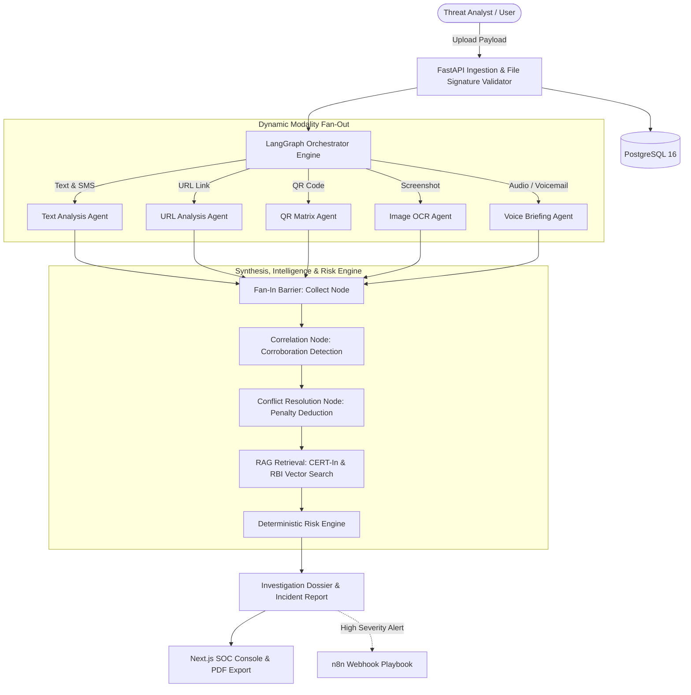
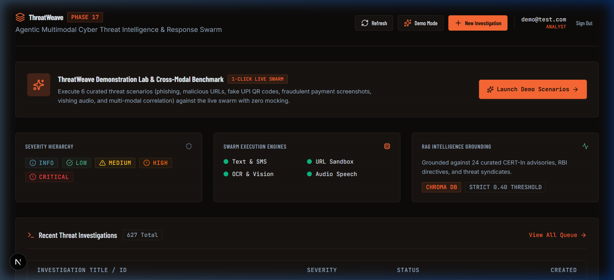
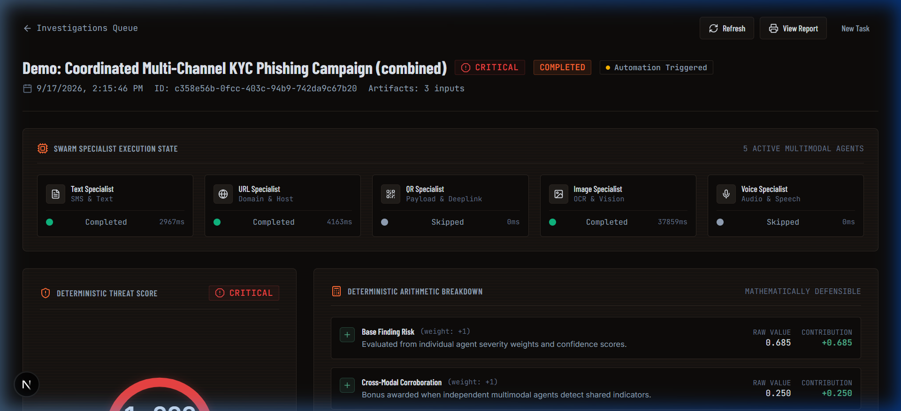
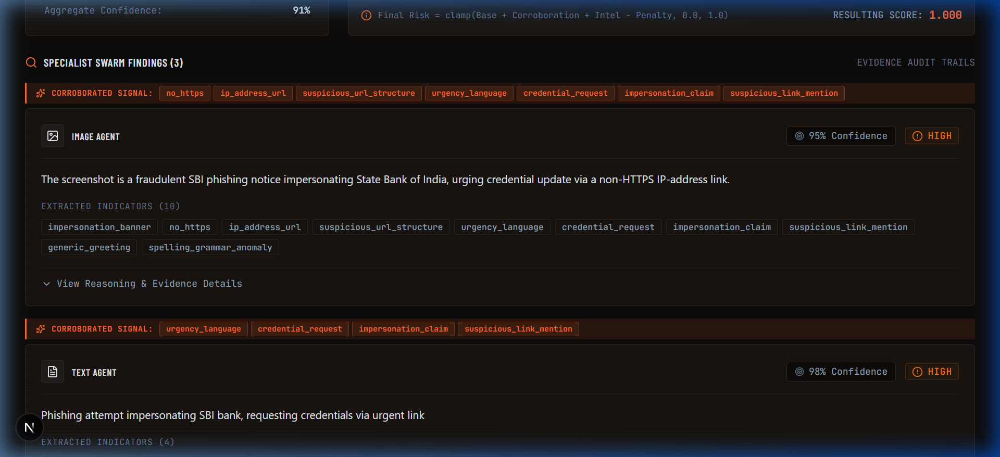
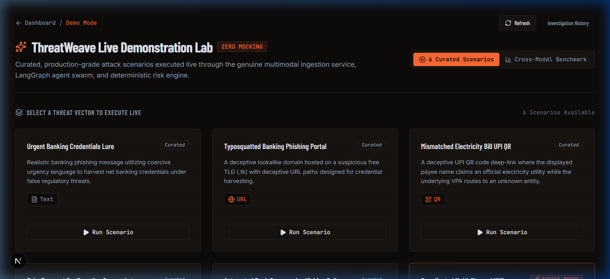

# ThreatWeave — Agentic Multimodal Cyber Threat Intelligence & Response

[](https://fastapi.tiangolo.com)
[](https://nextjs.org)
[](https://langchain-ai.github.io/langgraph/)
[](https://www.postgresql.org)
[](https://www.trychroma.com)
[](https://pytest.org)
[](https://playwright.dev)
[](https://www.typescriptlang.org)

**ThreatWeave** is an end-to-end, multi-agent cyber threat intelligence and fraud response platform engineered for B.Tech Computer Science & Engineering capstone research. The system is designed to correlate complex, multi-format cyber threat payloads—ranging from coercive SMS phishing lures and deceptive URLs to fake UPI payment QR codes, fraudulent bank transfer screenshots, and vishing voice notes.

Rather than relying on a single stochastic Large Language Model (which yields non-deterministic risk scores and cannot decode pixels or audio signals), ThreatWeave employs a **hierarchical swarm of five specialized analytical agents** governed by a stateful **LangGraph** orchestrator. Telemetry from specialist agents is correlated through an explainable, **purely deterministic mathematical risk engine** and grounded in **24 authoritative Indian national threat advisories (CERT-In and RBI)** indexed within a local vector database.

---

## System Architecture

ThreatWeave coordinates threat analysis through a stateful directed acyclic/cyclic workflow powered by **LangGraph**:



### Swarm Workflow Lifecycle
1. **Payload Ingestion & Validation:** Validates file magic bytes (JPEG, PNG, WebP, WAV) and records evidence items under strict tenant isolation.
2. **Conditional Fan-Out:** `plan_node` inspects input modalities and schedules only the relevant specialist agents concurrently.
3. **Consensus Fan-In:** `collect_node` waits for all scheduled agent runs to terminate.
4. **Corroboration & Conflict Resolution:** Analyzes semantic overlap across findings. Corroborating findings award a mathematical bonus ($+0.10$ per additional agent, capped at $+0.25$); contradictory findings trigger a contradiction penalty ($-0.10$ per conflict, capped at $0.30$) and log an audit trace to `conflict_logs`.
5. **RAG Vector Grounding:** Extracts technical observables and queries ChromaDB against 24 indexed CERT-In/RBI threat advisories using dense cosine embeddings ($\sigma \ge 0.40$).
6. **Deterministic Risk Scoring:** Computes the composite risk score and maps it to discrete severity bands (`info`, `low`, `medium`, `high`, `critical`).

---

## Specialist Agents Deep-Dive

ThreatWeave couples deterministic computer vision, heuristics, and signal processing tools with bounded LLM synthesis:

| Specialist Agent | Substrate & Technologies | Primary Threat Indicators Evaluated | Resilient Fallback Mechanism |
| :--- | :--- | :--- | :--- |
| **`Text Agent`** | Groq (`openai/gpt-oss-120b`), JSON Mode | Coercive urgency, credential theft, utility cut-off threats, fake KYC lures, banking intimidation. | Local regex tokenization, urgency keyword heuristics, capped confidence ($0.60$). |
| **`URL Agent`** | Levenshtein Distance, Public Suffix, IP Regex | Typosquatting of banking domains (`onlinesbi`, `hdfcbank`), IP-literal hosts, suspicious free TLDs, entropy anomalies. | Pure local static heuristic inspection; no external DNS/reputation dependency required. |
| **`QR Agent`** | OpenCV (`cv2.QRCodeDetector`), UPI URI Parser | UPI deep-link extraction (`upi://pay`), payee VPA domain validation, payee name/handle mismatch detection. | Defensive format error trapping; returns safe non-raising evidence record. |
| **`Image Agent`** | Neural OCR (`EasyOCR`), PyTorch, OpenCV | Text overlay extraction from mobile payment receipts, banking alert screenshots, forged transaction confirmations. | Bounded fallback to raw OCR heuristic text extraction if LLM synthesis times out. |
| **`Voice Agent`** | `faster-whisper`, Librosa, Acoustic Telemetry | Speech-to-text transcript analysis for banking fraud; zero-crossing rate, RMS energy, and spectral rolloff extraction. | Acoustic anomaly confidence capped at $\le 0.40$; behavioral script analysis prioritized over deepfake claims. |

---

## Mathematical Risk Scoring Engine

Unlike opaque, stochastic prompt-based ratings, ThreatWeave's risk engine ([`app/agents/risk_engine.py`](file:///d:/ThreatWeave%20—%20Agentic%20Multimodal/threatweave/apps/api/app/agents/risk_engine.py)) is a **pure mathematical function with zero database, zero network, and zero LLM calls**.

$$\text{Final Risk Score} = \text{clamp}\Big( \text{base\_score} + \Delta_{\text{corrob}} + \Delta_{\text{intel}} - \Delta_{\text{contra}}, \; 0.0, \; 1.0 \Big)$$

### Mathematical Components
1. **Base Score ($\text{base\_score}$):** Confidence-weighted arithmetic mean across all valid non-failed findings:
   $$\text{base\_score} = \frac{1}{N} \sum_{i=1}^{N} \Big( W(\text{sev}_i) \times c_i' \Big)$$
   *Severity weights:* `info` ($0.00$), `low` ($0.25$), `medium` ($0.50$), `high` ($0.75$), `critical` ($1.00$).
2. **Corroboration Bonus ($\Delta_{\text{corrob}}$):** $+0.10$ per additional distinct agent confirming shared observables, capped at $+0.25$.
3. **Threat Intel Bonus ($\Delta_{\text{intel}}$):** $+0.15$ if at least one retrieved RAG advisory satisfies the cosine similarity threshold ($\sigma \ge 0.40$).
4. **Contradiction Penalty ($\Delta_{\text{contra}}$):** $-0.10$ per inter-agent semantic conflict, capped at $0.30$.
5. **Uncertainty Gating:** Flags `low_confidence = True` if fewer than 2 findings exist or average confidence $\bar{c} < 0.40$.

### Discrete Severity Mapping
| Continuous Score Range | Severity Band | Recommended SOC Action |
| :---: | :---: | :--- |
| **$0.00 - 0.19$** | `INFO` | Baseline logging; non-malicious indicator. |
| **$0.20 - 0.39$** | `LOW` | Minor anomaly; monitor user session. |
| **$0.40 - 0.59$** | `MEDIUM` | Suspicious indicator; manual analyst triage recommended. |
| **$0.60 - 0.79$** | `HIGH` | Verified threat; automated account isolation and credential reset lure blocking. |
| **$0.80 - 1.00$** | `CRITICAL` | Severe ongoing attack; immediate network block and automated n8n incident dispatch. |

*(For full mathematical formalization and worked academic examples, refer to [docs/risk-engine-formula.md](docs/risk-engine-formula.md)).*

---

## Enterprise Security & Multi-Tenant Authorization

ThreatWeave implements strict security controls across all layers:

1. **OWASP BOLA / IDOR Defense:**
   - Every operational endpoint (`GET /{id}`, `POST /{id}/analyze`, `GET /{id}/report`, `GET /{id}/report/pdf`) executes the `check_investigation_ownership` dependency.
   - Enforces `investigation.user_id == current_user.id`. Unauthorized cross-tenant requests return **HTTP 404 Not Found** (preventing ID enumeration) rather than 403 Forbidden.
   - Investigation listing (`GET /api/v1/investigations`) scopes the SQLAlchemy query to `user_id` **before** computing `count()` or applying pagination offsets.
2. **Safe Demo Mode Partitioning:**
   - Seeded benchmark investigations are owned by `system_analyst@threatweave.local`. The ownership dependency explicitly recognizes this seed user, permitting public read access for viva demonstrations while keeping enterprise investigations isolated.
3. **Fail-Loud Production Configuration:**
   - `validate_security_configuration()` executes during FastAPI startup. Outside `development` mode, the server terminates immediately if `JWT_SECRET_KEY` is empty or set to default strings.
4. **Magic Bytes File Upload Hardening:**
   - Image uploads require true JPEG (`\xff\xd8\xff`), PNG (`\x89PNG\r\n\x1a\n`), or WebP (`RIFF...WEBP`) signatures. Audio uploads require valid WAV (`RIFF...WAVE`), MP3, or M4A magic bytes. Mime-type spoofing is rejected with HTTP 422.
5. **Zero Credential Leakage:**
   - Password hashes (`bcrypt`) are excluded from all Pydantic schemas and sanitized from logging formatters.

---

## Technology Stack

| Layer | Technologies | Purpose |
| :--- | :--- | :--- |
| **Frontend Console** | Next.js 16 (Turbopack), React 19, TypeScript, Vanilla Tailwind CSS | Reactive SOC command dashboard, Evidence Flow Graph, formula trace drawer. |
| **API Backend** | Python 3.11, FastAPI (Async), Uvicorn (ASGI) | RESTful API engine, lifespan security validation, stream processing. |
| **Agent Orchestrator** | LangGraph, LangChain Core | Cyclic multi-agent state graph, conditional fan-out, fan-in barriers. |
| **Vision & Audio** | OpenCV (`cv2`), EasyOCR, PyTorch, faster-whisper, Librosa | Deterministic QR decoding, neural text OCR, local audio transcription. |
| **Databases** | PostgreSQL 16, ChromaDB (Vector Store) | Relational investigation states and 384-dimensional dense semantic RAG embeddings. |
| **Automation** | n8n, Webhooks | High-severity incident alerting and notification playbooks. |
| **Report Generation** | ReportLab (Server-Side PDF), CSS Print Media | Container-independent, deterministic binary `%PDF-` generation. |
| **Test Engineering** | Pytest, Playwright, HTTPX TestClient, ESLint | 218 backend unit/integration tests and 3 browser E2E test suites. |

---

## Step-by-Step Launch Guide (Windows 11 & Docker)

### Prerequisites
* **Docker Desktop** installed and running on Windows.
* **Python 3.11+** installed.
* **Node.js 20+** installed.
* Two terminal windows (PowerShell).

---

### Step 1: Start Background Infrastructure (Postgres, ChromaDB & n8n)

Open your first terminal in the repository root:

```powershell
cd "d:\ThreatWeave — Agentic Multimodal\threatweave"
docker-compose up -d
```

Verify that all three containers are active:
```powershell
docker-compose ps
```

*Expected Output:*
* `threatweave-postgres` (Port `5432` - Healthy)
* `threatweave-chromadb` (Port `8001` - Healthy)
* `threatweave-n8n` (Port `5678` - Healthy)

---

### Step 2: Launch the FastAPI Backend API

In your API terminal, initialize the virtual environment and start Uvicorn:

```powershell
cd "d:\ThreatWeave — Agentic Multimodal\threatweave\apps\api"
.\venv\Scripts\Activate.ps1
uvicorn app.main:app --host 127.0.0.1 --port 8000 --reload
```

#### Verify Backend Health Endpoint:
Open your browser or run in PowerShell:
```powershell
curl http://127.0.0.1:8000/api/v1/health
```

*Expected JSON Response:*
```json
{
  "status": "ok",
  "service": "threatweave-api",
  "version": "v1"
}
```

Interactive Swagger documentation is available at [http://127.0.0.1:8000/docs](http://127.0.0.1:8000/docs).

---

### Step 3: Launch the Next.js Frontend Console

In your second terminal window:

```powershell
cd "d:\ThreatWeave — Agentic Multimodal\threatweave\apps\web"
npm run dev
```

*Notice:* Next.js is explicitly pinned to **port 3000** (`next dev -p 3000`), completely avoiding collisions with backend port 8000.

---

### Step 4: Access and Use ThreatWeave

Open your web browser and navigate to:

👉 **[http://localhost:3000](http://localhost:3000)**

* **1-Click Live Swarm Demos:** Click **"Launch Demo Scenarios →"** or toggle **Demo Mode** in the header to execute pre-seeded multimodal incidents.
* **Manual Threat Analysis:** Click **"+ New Investigation"** to upload suspicious text, links, payment screenshots, QR codes, or voicemails to trigger the live LangGraph swarm.
* **Download Incident Dossier:** Generate structured server-side PDF reports via ReportLab with verifiable `%PDF-` binary signatures.

---

### Optional: Re-Seed Curated Viva Incidents

To reset the pre-loaded viva scenarios with fresh benchmark investigations:

```powershell
cd "d:\ThreatWeave — Agentic Multimodal\threatweave\apps\api"
.\venv\Scripts\python.exe scripts/seed_demo_queue.py
```

---

## Test Suite & Empirical Verification

ThreatWeave enforces rigorous test verification across unit, integration, concurrency, security, and end-to-end browser tiers:

```powershell
# Run the complete backend test suite (218 tests)
cd "d:\ThreatWeave — Agentic Multimodal\threatweave\apps\api"
.\venv\Scripts\pytest.exe tests/ -q
```

```powershell
# Run frontend linting & strict TypeScript typechecking
cd "d:\ThreatWeave — Agentic Multimodal\threatweave\apps\web"
npm run lint
npx tsc --noEmit
```

```powershell
# Run browser E2E test suite (Auth, Demo Flow, Swarm Polling)
cd "d:\ThreatWeave — Agentic Multimodal\threatweave\apps\web"
npx playwright test
```

### Verified Test Results Summary
* **Backend Pytest Suite:** **218 / 218 Passing (100%)**
  * Multi-Tenant Isolation & IDOR: `14 passed`
  * Security Hardening & Magic Bytes: `8 passed`
  * LangGraph Swarm & Concurrency: `2 passed` (4-thread concurrent execution, 0 finding leaks, 0 connection pool leaks)
  * Specialist Agents & Resilient Fallbacks: `85 passed`
  * Deterministic Risk Engine Formula: `14 passed`
  * RAG ChromaDB Retrieval & Citations: `12 passed`
  * Reports & Binary PDF Generation: `16 passed`
* **Frontend Static Verification:**
  * ESLint: `0 errors, 0 warnings`
  * TypeScript (`tsc --noEmit`): `0 type errors`
* **Playwright E2E:** **3 / 3 Specs Passing** (`auth-flow.spec.ts`, `demo-flow.spec.ts`, `investigation-flow.spec.ts`)

---

## Application Visual Showcase

| SOC Operations Dashboard | Real-Time Swarm Analysis & Telemetry |
| :---: | :---: |
|  |  |

| Evidence Flow Graph & Corroboration | Curated Multi-Modal Demo Lab |
| :---: | :---: |
|  |  |

---

## Academic Reference & Viva Voce Documentation

Comprehensive documentation has been prepared specifically for capstone defense and viva voce examinations:

* [**docs/viva-prep.md**](docs/viva-prep.md): Comprehensive examination reference featuring 15 deep technical questions & answers, a minute-by-minute 5-minute presentation script, and competitive differentiation against point solutions (VirusTotal, Windows Defender, Truecaller).
* [**docs/risk-engine-formula.md**](docs/risk-engine-formula.md): Full mathematical specification of the deterministic risk scoring engine, including formal definitions of base score, corroboration bonuses, contradiction penalties, and discrete severity bands.
* [**docs/known-limitations.md**](docs/known-limitations.md): Honest technical boundaries documenting voice agent acoustic limits, static URL redirect constraints, and vector corpus update scope.
* [**docs/demo-prep.md**](docs/demo-prep.md): Operational guide detailing the 6 curated demonstration incidents and zero-setup presentation workflows.

---

## Honest Technical Limitations & Responsible AI

Academic integrity requires clear articulation of system boundaries:
1. **Audio Deepfake Detection:** ThreatWeave evaluates **vishing behavioral scripts** (coercive banking language, OTP requests) and treats acoustic telemetry as weak advisory signals ($\le 0.40$ confidence). It explicitly disclaims definitive synthetic audio detection over compressed telephony channels.
2. **Static URL Heuristics:** The URL Agent statically inspects homoglyphs, IP hosts, and domain entropy. It does not execute dynamic JavaScript sandbox rendering or follow live HTTP redirect chains to protect against zero-day browser exploits.
3. **Curated Threat Knowledge:** RAG semantic grounding is indexed against 24 verified CERT-In and RBI bulletins; it operates as an authoritative national baseline rather than an unbounded real-time threat feed.

---

## License & Academic Attribution

Developed as a Major Project for the Bachelor of Technology (B.Tech) degree in Computer Science & Engineering.
Distributed under the MIT License. See `LICENSE` for details.
