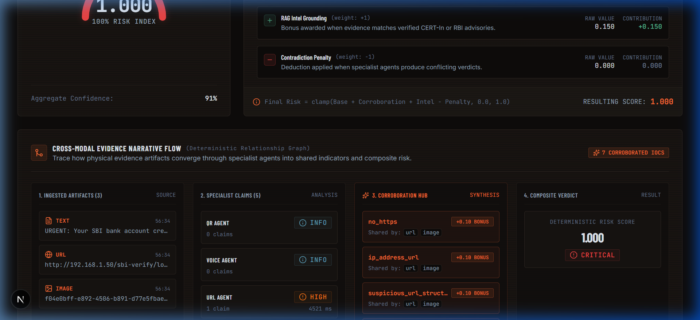
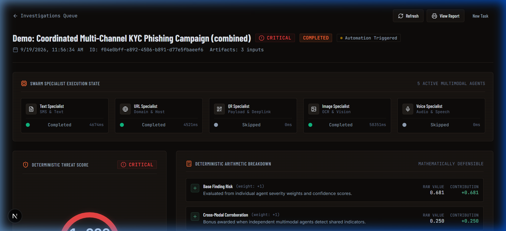
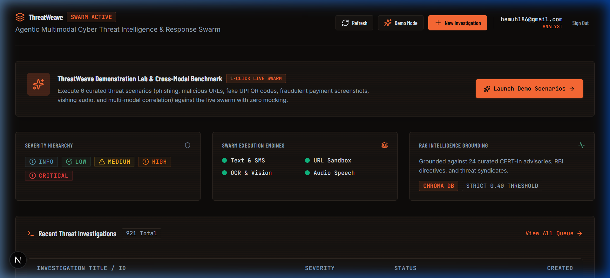
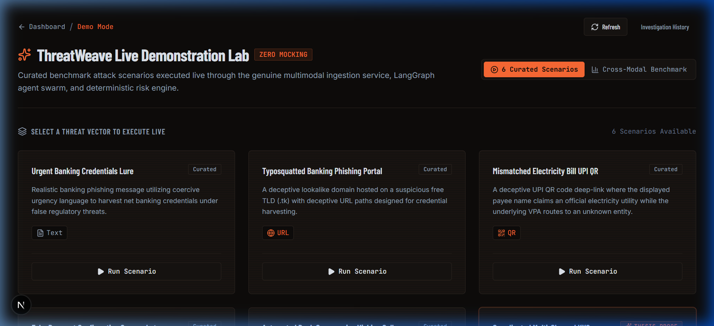
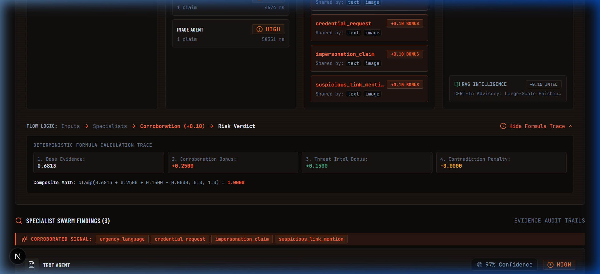

# ThreatWeave — Batch 1 Visual Verification Review
**Date**: September 19, 2026  
**Status**: Visual Inspection & Verification Complete  

This document catalogs the live visual verification screenshots captured for **Batch 1 (Evidence Flow Graph, Formula Trace Drawer, Severity-First Triage, and Phase Badge Fixes)**.

---

## 1. Cross-Modal Evidence Narrative Flow Component

* **Page**: `/investigations/[id]` (Live execution of `cross_modal` scenario)
* **What to inspect**:
  - **4-Stage Topology**:
    1. **Ingested Artifacts**: SMS Text, Payment QR/Screenshot, Verification URL with modality icons.
    2. **Specialist Claims**: Text Specialist, URL Specialist, and Image Specialist with severity tags and latencies.
    3. **Corroboration Hub**: Shows shared indicators (`sbi-kyc-update.top`, `urgency_language`) with `+0.10 BONUS` badges and distinct agent sources.
    4. **Composite Verdict**: Deterministic Risk Score (`1.000`), `CRITICAL` severity tag, and RAG Intelligence grounding summary (`+0.15 INTEL`).
  - **Flow Logic Bar**: Bottom connector bar tracing `Inputs → Specialists → Corroboration (+0.10) → Risk Verdict`.

---

## 2. Deterministic Formula Trace Drawer (Expanded)

* **Page**: `/investigations/[id]` (Clicked *"Inspect Formula Trace"*)
* **What to inspect**:
  - Full arithmetic transparency:
    - `1. Base Evidence`: `0.6813`
    - `2. Corroboration Bonus`: `+0.2500` (capped maximum)
    - `3. Threat Intel Bonus`: `+0.1500` (CERT-In advisory match)
    - `4. Contradiction Penalty`: `-0.0000`
  - Formula equation:
    `clamp(0.6813 + 0.2500 + 0.1500 - 0.0000, 0.0, 1.0) = 1.0000`

---

## 3. SOC Dashboard Header & Phase Badge Cleanup

* **Page**: `/` (Main SOC Operations Dashboard)
* **What to inspect**:
  - Header badge displays **`SWARM ACTIVE`** in Signal Intercept orange (replacing the temporary development artifact `PHASE 17`).
  - Metric cards and navigation reflect a clean, production-ready incident response console.

---

## 4. Demo Lab Copy Sanitization

* **Page**: `/demo` (Demonstration Lab)
* **What to inspect**:
  - Subtitle copy reads: *"Curated benchmark attack scenarios executed live through the genuine multimodal ingestion service, LangGraph agent swarm, and deterministic risk engine."* (replacing `"production-grade"`).

---

## 5. Severity-First Specialist Findings Dossier

* **Page**: `/investigations/[id]`
* **What to inspect**:
  - Findings are sorted danger-first: all `HIGH` severity findings render at the top of the feed rather than in arbitrary ingestion order.
  - Collapsible reasoning and payload metadata toggles are cleanly integrated.

