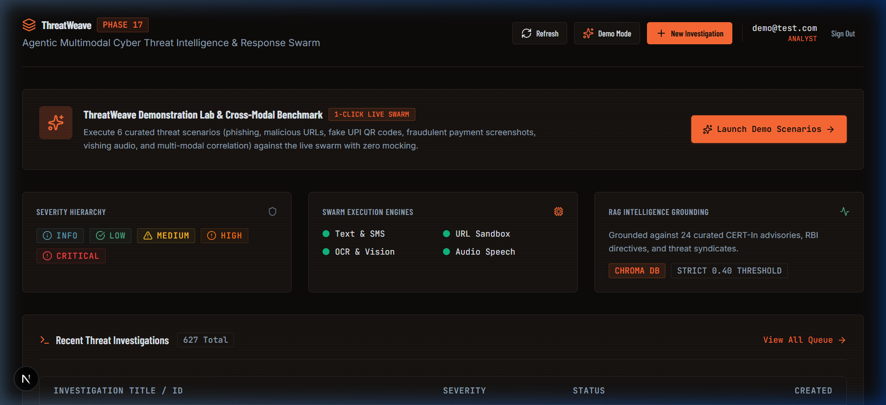
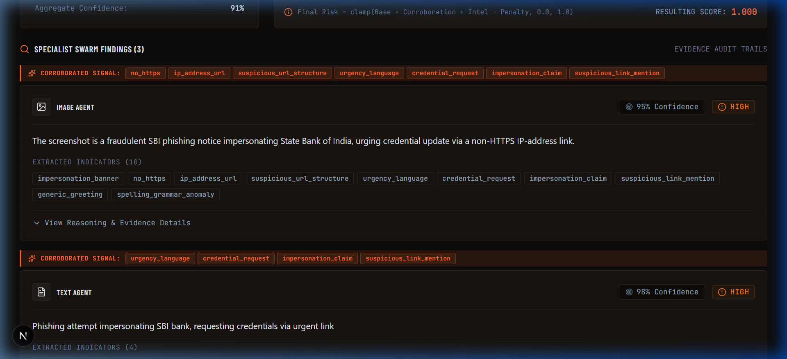
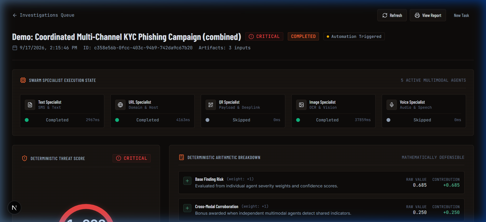
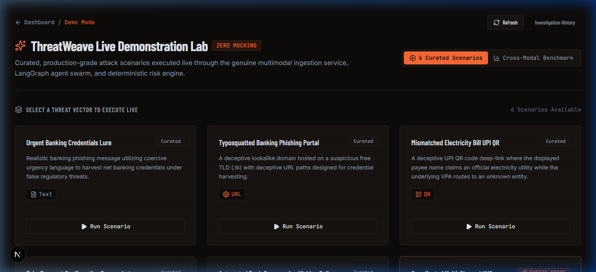
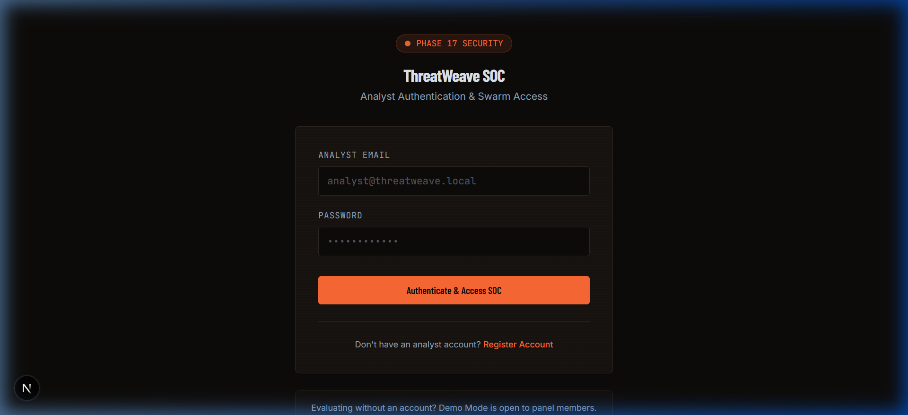

# ThreatWeave — Current Project State Snapshot & Reference Document

> **Audit Timestamp:** 2026-09-17  
> **Repository:** `threatweave` (Branch: `main`)  
> **State:** Live Operational Snapshot (Phases 1–20 Complete, "Signal Intercept" Restyled, Docker Subsystems Active)

---

## 1. Full Repository Tree

The tree below excludes `node_modules`, `venv`, `.git`, `__pycache__`, `.next`, transient caches, and dynamic storage uploads:

```
.
├── .env
├── .env.example
├── .env.prod
├── .github/
│   └── workflows/
│       ├── cd.yml
│       └── ci.yml
├── .gitignore
├── README.md
├── apps/
│   ├── api/
│   │   ├── .dockerignore
│   │   ├── .env
│   │   ├── Dockerfile
│   │   ├── alembic/
│   │   │   ├── README
│   │   │   ├── env.py
│   │   │   ├── script.py.mako
│   │   │   └── versions/
│   │   │       └── cf25626f42d2_initial_schema.py
│   │   ├── alembic.ini
│   │   ├── app/
│   │   │   ├── __init__.py
│   │   │   ├── agents/
│   │   │   │   ├── __init__.py
│   │   │   │   ├── correlation.py
│   │   │   │   ├── graph.py
│   │   │   │   ├── image_agent.py
│   │   │   │   ├── llm_client.py
│   │   │   │   ├── orchestrator_nodes.py
│   │   │   │   ├── orchestrator_state.py
│   │   │   │   ├── prompts/
│   │   │   │   │   ├── __init__.py
│   │   │   │   │   ├── image_agent_prompt.py
│   │   │   │   │   ├── qr_agent_prompt.py
│   │   │   │   │   ├── text_agent_prompt.py
│   │   │   │   │   ├── url_agent_prompt.py
│   │   │   │   │   └── voice_agent_prompt.py
│   │   │   │   ├── qr_agent.py
│   │   │   │   ├── reputation_client.py
│   │   │   │   ├── risk_engine.py
│   │   │   │   ├── text_agent.py
│   │   │   │   ├── url_agent.py
│   │   │   │   └── voice_agent.py
│   │   │   ├── api/
│   │   │   │   ├── __init__.py
│   │   │   │   ├── deps.py
│   │   │   │   └── v1/
│   │   │   │       ├── __init__.py
│   │   │   │       ├── endpoints/
│   │   │   │       │   ├── auth.py
│   │   │   │       │   ├── debug.py
│   │   │   │       │   ├── demo.py
│   │   │   │       │   ├── health.py
│   │   │   │       │   ├── investigations.py
│   │   │   │       │   ├── orchestration.py
│   │   │   │       │   ├── rag.py
│   │   │   │       │   └── reports.py
│   │   │   │       └── router.py
│   │   │   ├── core/
│   │   │   │   ├── __init__.py
│   │   │   │   ├── config.py
│   │   │   │   ├── errors.py
│   │   │   │   ├── file_validation.py
│   │   │   │   ├── image_heuristics.py
│   │   │   │   ├── indicators.py
│   │   │   │   ├── logging.py
│   │   │   │   ├── middleware.py
│   │   │   │   ├── ocr_engine.py
│   │   │   │   ├── qr_decoder.py
│   │   │   │   ├── security.py
│   │   │   │   ├── stt_engine.py
│   │   │   │   ├── url_heuristics.py
│   │   │   │   └── voice_heuristics.py
│   │   │   ├── db/
│   │   │   │   ├── __init__.py
│   │   │   │   ├── base.py
│   │   │   │   ├── base_class.py
│   │   │   │   └── session.py
│   │   │   ├── demo/
│   │   │   │   ├── fixtures/
│   │   │   │   │   ├── cross_modal_kyc.png
│   │   │   │   │   ├── fake_payment_qr.png
│   │   │   │   │   ├── fraudulent_screenshot.png
│   │   │   │   │   └── scam_voice.wav
│   │   │   │   ├── fixtures_builder.py
│   │   │   │   └── scenarios.py
│   │   │   ├── main.py
│   │   │   ├── models/
│   │   │   │   ├── __init__.py
│   │   │   │   ├── agent_finding.py
│   │   │   │   ├── agent_run.py
│   │   │   │   ├── conflict_log.py
│   │   │   │   ├── enums.py
│   │   │   │   ├── evidence_input.py
│   │   │   │   ├── investigation.py
│   │   │   │   ├── investigation_report.py
│   │   │   │   ├── rag_citation.py
│   │   │   │   ├── risk_breakdown.py
│   │   │   │   └── user.py
│   │   │   ├── rag/
│   │   │   │   ├── __init__.py
│   │   │   │   ├── chroma_client.py
│   │   │   │   ├── chunking.py
│   │   │   │   ├── embeddings.py
│   │   │   │   ├── ingest.py
│   │   │   │   ├── retriever.py
│   │   │   │   └── sources/
│   │   │   │       ├── cert_in/
│   │   │   │       ├── rbi/
│   │   │   │       └── scam_intel/
│   │   │   ├── schemas/
│   │   │   │   ├── __init__.py
│   │   │   │   ├── auth.py
│   │   │   │   ├── common.py
│   │   │   │   ├── evidence.py
│   │   │   │   ├── investigation.py
│   │   │   │   └── rag.py
│   │   │   └── services/
│   │   │       ├── __init__.py
│   │   │       ├── auth_service.py
│   │   │       ├── base.py
│   │   │       ├── ingestion_service.py
│   │   │       ├── orchestration_service.py
│   │   │       ├── report_service.py
│   │   │       ├── storage.py
│   │   │       └── webhook_service.py
│   │   ├── pytest.ini
│   │   ├── requirements.txt
│   │   ├── scripts/
│   │   │   ├── ingest_corpus.py
│   │   │   └── preload_models.py
│   │   └── tests/ (24 test suites, 197 passed tests)
│   └── web/
│       ├── .dockerignore
│       ├── .env.example
│       ├── .env.local
│       ├── .gitignore
│       ├── AGENTS.md
│       ├── CLAUDE.md
│       ├── Dockerfile
│       ├── README.md
│       ├── app/
│       │   ├── demo/
│       │   │   └── page.tsx
│       │   ├── favicon.ico
│       │   ├── globals.css
│       │   ├── investigations/
│       │   │   ├── [id]/
│       │   │   │   ├── page.tsx
│       │   │   │   └── report/
│       │   │   │       └── page.tsx
│       │   │   ├── new/
│       │   │   │   └── page.tsx
│       │   │   └── page.tsx
│       │   ├── layout.tsx
│       │   ├── login/
│       │   │   └── page.tsx
│       │   ├── page.tsx
│       │   └── register/
│       │       └── page.tsx
│       ├── components/
│       │   ├── auth/
│       │   │   └── AuthGuard.tsx
│       │   ├── demo/
│       │   │   ├── ComparisonView.tsx
│       │   │   └── ScenarioCard.tsx
│       │   ├── history/
│       │   │   ├── FilterBar.tsx
│       │   │   └── InvestigationRow.tsx
│       │   ├── investigation/
│       │   │   ├── AgentActivityStrip.tsx
│       │   │   ├── ConflictBanner.tsx
│       │   │   ├── EvidenceCard.tsx
│       │   │   ├── RagCitationPanel.tsx
│       │   │   ├── RiskBreakdownPanel.tsx
│       │   │   ├── RiskGauge.tsx
│       │   │   └── UploadForm.tsx
│       │   └── ui/
│       │       ├── Badge.tsx
│       │       ├── Button.tsx
│       │       ├── Card.tsx
│       │       ├── EmptyState.tsx
│       │       ├── SeverityTag.tsx
│       │       ├── Skeleton.tsx
│       │       └── StatusDot.tsx
│       ├── eslint.config.mjs
│       ├── lib/
│       │   ├── api.ts
│       │   ├── auth.ts
│       │   ├── tokens.ts
│       │   └── types.ts
│       ├── next.config.ts
│       ├── package.json
│       ├── postcss.config.mjs
│       └── tsconfig.json
├── docker-compose.prod.yml
├── docker-compose.yml
├── docs/
│   ├── ci-cd-setup.md
│   ├── design-system.md
│   ├── docker-setup.md
│   ├── known-limitations.md
│   ├── n8n-setup.md
│   ├── screenshots/
│   │   ├── 01_dashboard.png
│   │   ├── 02_demo_picker.png
│   │   ├── 03_investigation_top.png
│   │   ├── 04_investigation_corroboration.png
│   │   └── 05_login.png
│   └── visual-review.md
├── infra/
│   ├── docker/
│   ├── github-actions/
│   │   └── ci.yml
│   └── nginx/
├── n8n/
│   └── workflows/
│       └── high_severity_alert.json
└── storage/
```

---

## 2. Backend Structure Summary (`apps/api/app/`)

### Application Root
- **`app/main.py`**: Initializes FastAPI ASGI app, security lifespan validation, CORS, request telemetry middleware, and route mounting.

### Specialist Agents Subsystem (`app/agents/`)
- **`app/agents/correlation.py`**: Finds cross-agent corroborating indicators and flags contradictory findings between agents.
- **`app/agents/graph.py`**: Compiles the LangGraph StateGraph orchestrator machine for dynamic multi-modal agent routing and parallel execution.
- **`app/agents/image_agent.py`**: Orchestrates EasyOCR neural text extraction, heuristic visual pattern matching, and LLM structured synthesis.
- **`app/agents/llm_client.py`**: Wraps the Groq SDK client with JSON-mode enforcement, timeout control, and deterministic rule-based fallback.
- **`app/agents/orchestrator_nodes.py`**: Implements individual node execution functions for classification, planning, agent calls, RAG, and risk scoring.
- **`app/agents/orchestrator_state.py`**: Defines LangGraph state schemas (`InvestigationState`, `RoutingTarget`) tracking execution across transitions.
- **`app/agents/qr_agent.py`**: Decodes QR code matrices via OpenCV, detects UPI fraud patterns, validates VPAs, and delegates text payloads.
- **`app/agents/reputation_client.py`**: External URL and domain reputation API client with strict timeout control and offline fallback.
- **`app/agents/risk_engine.py`**: Deterministic mathematical risk scoring engine computing composite threat scores (0–100) and severity bands.
- **`app/agents/text_agent.py`**: Analyzes plain-text lures and SMS messages for social engineering, urgency, and credential-harvesting patterns.
- **`app/agents/url_agent.py`**: Parses suspicious URLs, computes typosquatting distance, inspects IP hosts, TLD risk, and path entropy.
- **`app/agents/voice_agent.py`**: Transcribes voice recordings via `faster-whisper`, extracts acoustic telemetry, and evaluates vishing scripts without claiming deepfake proof.
- **`app/agents/prompts/image_agent_prompt.py`**: Directs LLM synthesis of OCR-extracted screenshot text and visual fraud markers.
- **`app/agents/prompts/qr_agent_prompt.py`**: Directs LLM analysis of plain-text payloads extracted from QR code matrices.
- **`app/agents/prompts/text_agent_prompt.py`**: Directs structured JSON threat classification for textual communications and social engineering lures.
- **`app/agents/prompts/url_agent_prompt.py`**: Directs synthesis of structural URL heuristic flags into structured threat findings.
- **`app/agents/prompts/voice_agent_prompt.py`**: Directs structured evaluation of transcribed voice call scripts for impersonation and bank urgency.

### API Routing Layer (`app/api/`)
- **`app/api/deps.py`**: FastAPI dependency providers for SQLAlchemy database sessions and JWT bearer token authentication.
- **`app/api/v1/router.py`**: Aggregates all version 1 endpoints into a unified `APIRouter` mounted under `/api/v1`.
- **`app/api/v1/endpoints/auth.py`**: Authentication endpoints for user registration, user login, and profile lookup (`/auth/me`).
- **`app/api/v1/endpoints/debug.py`**: Direct invocation debug endpoints to test each of the 5 specialist agents individually.
- **`app/api/v1/endpoints/demo.py`**: Endpoints listing curated demonstration scenarios and executing live end-to-end benchmark investigations.
- **`app/api/v1/endpoints/health.py`**: Versioned health check endpoint reporting database, service, and component readiness.
- **`app/api/v1/endpoints/investigations.py`**: Endpoints for ingesting multi-modal evidence, listing paginated investigations, and fetching investigation details.
- **`app/api/v1/endpoints/orchestration.py`**: Endpoint triggering the LangGraph swarm orchestration pipeline for an investigation.
- **`app/api/v1/endpoints/rag.py`**: Ad-hoc semantic similarity search endpoint querying the ChromaDB threat advisory collection.
- **`app/api/v1/endpoints/reports.py`**: Endpoint generating and retrieving comprehensive investigation report audit payloads.

### Core Framework & Heuristics (`app/core/`)
- **`app/core/config.py`**: Centralized Pydantic `Settings` class loading environment variables, defaults, and validation rules.
- **`app/core/errors.py`**: Custom domain exception classes (`ThreatWeaveError`, `ValidationError`, etc.) and HTTP JSON exception handlers.
- **`app/core/file_validation.py`**: Security validators checking file magic bytes, MIME types, extension whitelists, and maximum file sizes.
- **`app/core/image_heuristics.py`**: Pure, network-free regex analysis on OCR text detecting fake payment confirmations and entity impersonation.
- **`app/core/indicators.py`**: Strongly-typed container class and validation rules for technical and behavioral threat indicators.
- **`app/core/logging.py`**: Custom JSON log formatter injecting timestamp, log level, request ID, and correlation metadata.
- **`app/core/middleware.py`**: `RequestTelemetryMiddleware` generating unique UUID `X-Request-ID` headers and logging request latency.
- **`app/core/ocr_engine.py`**: Singleton wrapper managing EasyOCR neural model loading and CPU inference for image text extraction.
- **`app/core/qr_decoder.py`**: OpenCV-backed QR detector decoding high-density and stylized barcodes from image bytes.
- **`app/core/security.py`**: Cryptographic utilities for bcrypt password hashing, JWT token creation, and fail-loud production secret checks.
- **`app/core/stt_engine.py`**: Singleton wrapper running `faster-whisper` (base model) for offline audio speech-to-text transcription.
- **`app/core/url_heuristics.py`**: Pure deterministic heuristics computing Levenshtein distance, homoglyphs, IP hosts, and suspicious TLDs.
- **`app/core/voice_heuristics.py`**: Audio signal feature extraction (RMS energy, spectral rolloff, zero-crossing rate) and vishing keyword scanning.

### Database Layer (`app/db/`)
- **`app/db/base.py`**: Imports all SQLAlchemy ORM models into a unified namespace so Alembic can autogenerate migrations.
- **`app/db/base_class.py`**: Declares SQLAlchemy's `Base` declarative class with automatic lowercase `__tablename__` resolution.
- **`app/db/session.py`**: Creates the SQLAlchemy engine, `sessionmaker`, and yields transactional database sessions.

### Demo Suite (`app/demo/`)
- **`app/demo/fixtures_builder.py`**: Programmatically generates and validates binary test fixtures (PNG, WAV) on disk for demo scenarios (`fake_payment_qr.png`, `fraudulent_screenshot.png`, `scam_voice.wav`, `cross_modal_kyc.png`).
- **`app/demo/scenarios.py`**: Defines the 6 canonical demonstration scenarios executing the genuine live ingestion and swarm orchestration pipeline:
  1. **`phishing_email`** (*"Urgent Banking Credentials Lure"*): Text modality — coercive urgency language harvesting net banking credentials under false regulatory threats.
  2. **`malicious_url`** (*"Typosquatted Banking Phishing Portal"*): URL modality — deceptive lookalike domain on a suspicious free TLD (`.tk`) targeting net banking credentials.
  3. **`fake_payment_qr`** (*"Mismatched Electricity Bill UPI QR"*): QR/Image modality — deceptive UPI QR deep-link with payee name mismatch routing to an unknown entity VPA.
  4. **`fraudulent_screenshot`** (*"Fake Payment Confirmation Screenshot"*): Image modality — forged instant payment confirmation graphic purporting a Rs. 49,999 transfer.
  5. **`scam_voice`** (*"Automated Bank Compromise Vishing Call"*): Voice/Audio modality — automated vishing audio script alerting victim to fraudulent compromise to elicit PIN revelation.
  6. **`cross_modal`** (*"Coordinated Multi-Channel KYC Phishing Campaign"*): Multi-modal (Text + URL + Image) — coordinated banking attack combining an SMS security lure, lookalike verification URL, and forged official bank notification screenshot. Supports execution in `combined`, `text_only`, `url_only`, and `image_only` modes for thesis comparison.

### Data Models (`app/models/`)
- **`app/models/agent_finding.py`**: ORM model storing individual specialist agent findings, confidence, severity, indicators, and reasoning.
- **`app/models/agent_run.py`**: ORM model tracking each agent execution lifecycle (status, start/finish timestamps, latency ms).
- **`app/models/conflict_log.py`**: ORM model recording agent contradictions, conflict types, and applied resolution rules.
- **`app/models/enums.py`**: Python enumerations defining `Severity`, `Modality`, `AgentStatus`, `FindingStatus`, and `SourceType`.
- **`app/models/evidence_input.py`**: ORM model storing raw uploaded evidence metadata, modalities, and disk file paths.
- **`app/models/investigation.py`**: Primary ORM entity tracking investigation title, user ownership, execution status, and final risk score.
- **`app/models/investigation_report.py`**: ORM model maintaining an immutable audit log of generated investigation report exports.
- **`app/models/rag_citation.py`**: ORM model persisting vector-matched threat intelligence advisories linked to an investigation.
- **`app/models/risk_breakdown.py`**: ORM model recording individual numerical risk components, assigned weights, and contributions.
- **`app/models/user.py`**: ORM model storing user accounts, email addresses, bcrypt password hashes, and authorization roles.

### Retrieval-Augmented Generation (`app/rag/`)
- **`app/rag/chroma_client.py`**: ChromaDB connection factory connecting to the HTTP service with fallback to local persistent disk storage.
- **`app/rag/chunking.py`**: Paragraph-aware document chunker splitting markdown advisories into 300–500 token segments with frontmatter parsing.
- **`app/rag/embeddings.py`**: Local CPU-only embedding engine using `sentence-transformers/all-MiniLM-L6-v2` (384 dimensions).
- **`app/rag/ingest.py`**: Idempotent indexing script reading markdown files from `app/rag/sources/` and upserting chunks into ChromaDB.
- **`app/rag/retriever.py`**: Vector search retriever executing similarity-filtered queries with a strict 0.40 similarity threshold.

### Schemas & Services (`app/schemas/` & `app/services/`)
- **`app/schemas/auth.py`**: Pydantic request and response models for user registration, login, and JWT access tokens.
- **`app/schemas/common.py`**: Generic envelope models, pagination wrappers, and error detail schemas.
- **`app/schemas/evidence.py`**: Pydantic model representing internal evidence findings passed between agents.
- **`app/schemas/investigation.py`**: Complete Pydantic schemas for investigation creation, status responses, and deep nested details.
- **`app/schemas/rag.py`**: Pydantic models for semantic advisory search results and similarity scores.
- **`app/services/auth_service.py`**: Business logic executing password verification, user creation, and JWT issuance.
- **`app/services/base.py`**: Generic base service class providing common transactional database helper routines.
- **`app/services/ingestion_service.py`**: Handles incoming multi-modal evidence inputs, file persistence, and investigation entity creation.
- **`app/services/orchestration_service.py`**: Executes the compiled LangGraph workflow and dispatches n8n webhook notifications on high severity.
- **`app/services/report_service.py`**: Assembles comprehensive Markdown and JSON incident report summaries with audit logging.
- **`app/services/storage.py`**: Abstract and local disk storage implementation for persisting uploaded media files.
- **`app/services/webhook_service.py`**: Dispatches HTTP POST webhooks to n8n for high/critical security alerts with non-blocking error handling.

---

## 3. Frontend Structure Summary (`apps/web/`)

### Pages & App Router (`apps/web/app/`)
- **`app/layout.tsx`**: Root application shell injecting fonts (`Inter`, `Barlow_Condensed`, `JetBrains_Mono`), HTML boilerplate, and metadata.
- **`app/page.tsx`**: Main SOC operations dashboard showing quick launch banner, severity hierarchy, swarm status cards, and recent investigations table.
- **`app/demo/page.tsx`**: Demonstration Lab page offering 1-click execution for 6 curated threat scenarios with side-by-side modal comparisons.
- **`app/investigations/page.tsx`**: Full investigation history queue with severity filtering, search, pagination, and status badges.
- **`app/investigations/new/page.tsx`**: Multi-modal upload console allowing analysts to submit text, URLs, images, or audio files for swarm analysis.
- **`app/investigations/[id]/page.tsx`**: Live investigation workspace featuring the agent activity strip, circular risk gauge, breakdown panel, evidence cards, conflict banner, and RAG citations.
- **`app/investigations/[id]/report/page.tsx`**: Executive report view formatting the investigation into an exportable, printable security dossier with Markdown and JSON download options.
- **`app/login/page.tsx`**: Analyst authentication page with email and password input fields, error banners, and redirection to the requested URL.
- **`app/register/page.tsx`**: Account registration page creating new analyst accounts with role selection and input validation.
- **`app/globals.css`**: TailwindCSS v4 stylesheet defining `@theme` variables matching the design token system and high-contrast focus rings.

### Feature Components (`apps/web/components/`)
- **`components/auth/AuthGuard.tsx`**: Client-side route guard ensuring unauthenticated users are redirected to `/login` before accessing protected routes.
- **`components/demo/ComparisonView.tsx`**: Side-by-side comparison modal contrasting single-modality findings against multi-modal swarm synthesis.
- **`components/demo/ScenarioCard.tsx`**: Interactive card component displaying a demo scenario's description, modalities, expected severity, and "Run Scenario" button.
- **`components/history/FilterBar.tsx`**: Filter toolbar allowing analysts to filter the investigation queue by status, severity, and search term.
- **`components/history/InvestigationRow.tsx`**: Table row component rendering investigation title, ID, severity tag, status badge, and creation timestamp.
- **`components/investigation/AgentActivityStrip.tsx`**: Visual strip displaying the execution status, latency, and indicator badges for all 5 specialist agents.
- **`components/investigation/ConflictBanner.tsx`**: Prominent alert banner rendered when cross-agent conflicts occur, showing contradictory agents and the resolution rule applied.
- **`components/investigation/EvidenceCard.tsx`**: Card rendering raw submitted evidence, OCR text overlays, and audio players.
- **`components/investigation/RagCitationPanel.tsx`**: Panel displaying grounded CERT-In and RBI threat intelligence citations with similarity percentage tags.
- **`components/investigation/RiskBreakdownPanel.tsx`**: Visual breakdown showing the exact mathematical weights and contributions of each risk component.
- **`components/investigation/RiskGauge.tsx`**: Circular SVG dial visualizing the composite risk score (0–100) with color transition based on severity.
- **`components/investigation/UploadForm.tsx`**: Multi-tab upload form supporting text input, URL entry, image drag-and-drop, and audio recording upload.

### Base UI Components (`apps/web/components/ui/`)
- **`components/ui/Badge.tsx`**: Compact tag component supporting `default`, `outline`, and `accent` variants for status indicators and versions.
- **`components/ui/Button.tsx`**: Interactive button component with `primary`, `secondary`, and `ghost` variants, 3 sizes, and focus rings.
- **`components/ui/Card.tsx`**: Base container card with SOC border, dark surface background, and subtle CSS phosphor scanline overlay.
- **`components/ui/EmptyState.tsx`**: Empty state container displaying an icon, title, descriptive message, and an action button.
- **`components/ui/SeverityTag.tsx`**: Strongly-typed 5-tier threat badge (`info`, `low`, `medium`, `high`, `critical`) with matching Lucide icons.
- **`components/ui/Skeleton.tsx`**: Pulsing placeholder element displaying animated loading states with motion-reduction compliance.
- **`components/ui/StatusDot.tsx`**: Glowing dot indicator showing agent pipeline state (`idle`, `running`, `done`, `failed`).

### Frontend Libraries (`apps/web/lib/`)
- **`lib/api.ts`**: Typed API client wrapping `fetch` requests to the FastAPI backend, supporting both `NEXT_PUBLIC_API_BASE_URL` and `NEXT_PUBLIC_API_URL`.
- **`lib/auth.ts`**: Client-side authentication utilities managing JWT storage in `localStorage`, user profiles, and authorization headers.
- **`lib/tokens.ts`**: Design system tokens defining exact hex color codes, spacing scales, font bindings, and border radii.
- **`lib/types.ts`**: TypeScript type definitions matching backend Pydantic schemas and database models.

---

## 4. Design System Audit

### Color Tokens & Actual Hex Values in Use

| Token Category | Token Key | Current Hex / CSS Value | Description & Visual Role |
| :--- | :--- | :--- | :--- |
| **Theme Backgrounds** | `bg.base` | `#0E0C0B` | Warm near-black command console backdrop |
| | `bg.surface` | `#161311` | Cards, table frames, panel divisions |
| | `bg.elevated` | `#211D1A` | Modals, popovers, dropdown drawers, active items |
| | `bg.border` | `#2E2722` | Subtle warm amber-gray structural boundaries |
| **Typography Contrast** | `text.primary` | `#E2E8F0` | High-contrast labels, titles, and active text |
| | `text.secondary` | `#94A3B8` | Muted descriptive copy, descriptions, metadata |
| | `text.muted` | `#64748B` | Timestamps, IDs, disabled items, placeholders |
| **Primary Accents** | `accent.primary` | `#FF6B35` | Signal Orange: primary buttons, highlights, badges |
| | `accent.hover` | `#E85520` | Deep rust-orange hover transition state |
| | `accent.outline` | `rgba(255, 107, 53, 0.4)` | Focus ring outline shadow for keyboard navigation |
| **5-Tier Severity** | `severity.info` | `#5B9EB8` | Desaturated steel-cyan (low dominance) |
| | `severity.low` | `#4EAB87` | Desaturated sage-green (low dominance) |
| | `severity.medium` | `#FBBF24` | Amber Yellow (moderate warning) |
| | `severity.high` | `#F97316` | Alert Orange (active threat campaign) |
| | `severity.critical` | `#EF4444` | Crimson Red (urgent security incident) |
| **Pipeline Status Dots** | `status.idle` | `#94A3B8` | Slate Gray (awaiting input) |
| | `status.running` | `#3B82F6` | Blue (active processing state) |
| | `status.done` | `#10B981` | Vibrant Green (successful execution) |
| | `status.failed` | `#EF4444` | Red (failed task execution) |

### Font Families & Scope of Application

1. **Display Font (`--font-display` -> `Barlow_Condensed`):**
   - **Applied to:** Main dashboard titles, page headers, panel headings, card titles, buttons, statistics, and uppercase technical section headers.
   - **Rationale:** Delivers a narrow, high-density tactical field-report aesthetic characteristic of defense SIGINT monitoring consoles.
2. **Body Font (`--font-body` -> `Inter`):**
   - **Applied to:** Standard UI copy, form labels, input fields, and body descriptions.
   - **Rationale:** Highest legibility for dense UI copy and explanatory analysis text.
3. **Monospace Font (`--font-mono` -> `JetBrains_Mono`):**
   - **Applied to:** Investigation UUIDs, severity codes, agent latency indicators, technical indicators, and raw JSON payloads.
   - **Rationale:** Clean tabular alignment for cryptographic hashes, IP addresses, and telemetry metrics.

### Spacing & Border Radii Scales

- **Spacing Scale (4px Base Grid):**
  - `xs`: `0.25rem` (4px) — Badge padding, status dot margins.
  - `sm`: `0.5rem` (8px) — Button padding, inline label gaps.
  - `md`: `0.75rem` (12px) — Card element gaps, list item spacing.
  - `lg`: `1rem` (16px) — Standard container padding, form field spacing.
  - `xl`: `1.5rem` (24px) — Main card paddings, grid column gaps.
  - `xxl`: `2rem` (32px) — Major section margins and page header paddings.
- **Border Radii Scale:**
  - `none`: `0px` — Sharp tables and square dividers.
  - `sm`: `2px` — Tags, severity badges, and status chips.
  - `md`: `4px` — Buttons, text inputs, and select menus.
  - `lg`: `6px` — Main cards, panels, and modal containers.
  - `full`: `9999px` — Circular status indicator dots and pills.

### Base UI Components Specification (`components/ui/`)

- **`Badge`**: Renders compact metadata tags; accepts `variant?: "default" | "outline" | "accent"` and `HTMLSpanElement` attributes.
- **`Button`**: Renders keyboard-accessible buttons with focus rings; accepts `variant?: "primary" | "secondary" | "ghost"`, `size?: "sm" | "md" | "lg"`, and `ButtonHTMLAttributes`.
- **`Card`**: Renders dark surface container with subtle CSS phosphor scanline overlay; accepts `hoverable?: boolean` and `HTMLDivElement` attributes.
- **`EmptyState`**: Renders empty-list layout with icon, text, and action CTA; accepts `title: string`, `description: string`, `action?: React.ReactNode`, and `HTMLDivElement` attributes.
- **`SeverityTag`**: Renders 5-tier threat badge with icon; accepts `severity: "info" | "low" | "medium" | "high" | "critical"` and `HTMLSpanElement` attributes.
- **`Skeleton`**: Renders pulsing loading placeholder with motion-reduction compliance; accepts `HTMLDivElement` attributes.
- **`StatusDot`**: Renders glowing circular agent pipeline status dot; accepts `status: "idle" | "running" | "done" | "failed"`, `showLabel?: boolean`, and `HTMLSpanElement` attributes.

### Actual Visual State Screenshots

The following live screenshots confirm the visual state:

#### 1. Main SOC Dashboard (`/`)
* **Live Artifact:** [docs/screenshots/01_dashboard.png](file:///d:/ThreatWeave%20—%20Agentic%20Multimodal/threatweave/docs/screenshots/01_dashboard.png)
* **Visual Breakdown:** Renders Barlow Condensed headers, warm near-black background (`#0E0C0B`), scanline cards, signal-orange primary actions (`#FF6B35`), and desaturated `INFO`/`LOW` severity chips.



#### 2. Investigation Workspace — Corroboration Badges (`/investigations/[id]`)
* **Live Artifact:** [docs/screenshots/04_investigation_corroboration.png](file:///d:/ThreatWeave%20—%20Agentic%20Multimodal/threatweave/docs/screenshots/04_investigation_corroboration.png)
* **Visual Breakdown:** Completed multi-modal investigation (`c358e56b-0fcc-403c-94b9-742da9c67b20`). Directly above the Image and Text agent cards, the distinct **`CORROBORATED SIGNAL:`** callout banner renders with an accent left border (`border-l-2 border-accent-primary`) displaying shared indicators (`no_https`, `ip_address_url`, `urgency_language`, `impersonation_claim`).



#### 3. Investigation Workspace — Command Console & Risk Gauge (`/investigations/[id]`)
* **Live Artifact:** [docs/screenshots/03_investigation_top.png](file:///d:/ThreatWeave%20—%20Agentic%20Multimodal/threatweave/docs/screenshots/03_investigation_top.png)
* **Visual Breakdown:** Shows the 5-agent execution status strip, circular SVG `RiskGauge` displaying a 1.000 Critical score, and the deterministic arithmetic breakdown panel.



#### 4. Demo Scenario Benchmark Picker (`/demo`)
* **Live Artifact:** [docs/screenshots/02_demo_picker.png](file:///d:/ThreatWeave%20—%20Agentic%20Multimodal/threatweave/docs/screenshots/02_demo_picker.png)
* **Visual Breakdown:** The 6-scenario benchmark suite styled with tactical scanline cards, condensed category badges (`Text`, `URL`, `QR`), and signal-orange execution triggers.



#### 5. Analyst Authentication Screen (`/login`)
* **Live Artifact:** [docs/screenshots/05_login.png](file:///d:/ThreatWeave%20—%20Agentic%20Multimodal/threatweave/docs/screenshots/05_login.png)
* **Visual Breakdown:** Elevated center card with warm amber-gray borders (`#2E2722`), scanline texture overlay, and high-contrast primary authentication button.



---

## 5. API Surface Summary

Mounted routes across FastAPI backend (`app.main:app` and `api/v1/router.py`):

- **`POST` `/api/v1/auth/register`**: Registers a new analyst user account with email, password hash, and role.
- **`POST` `/api/v1/auth/login`**: Verifies user credentials and issues a signed HS256 JWT access token.
- **`GET` `/api/v1/auth/me`**: Returns profile and permissions of the currently authenticated analyst.
- **`GET` `/api/v1/health`**: Version 1 health check verifying database and service subsystem readiness.
- **`GET` `/health`**: Legacy unversioned health check for backwards compatibility.
- **`POST` `/api/v1/investigations`**: Ingests multi-modal evidence inputs (text, URLs, images, audio) and creates an investigation.
- **`GET` `/api/v1/investigations`**: Retrieves a paginated list of investigations with title, severity, status, and timestamps.
- **`GET` `/api/v1/investigations/{id}`**: Fetches complete investigation details including evidence, agent findings, runs, and risk breakdown.
- **`POST` `/api/v1/investigations/{id}/analyze`**: Triggers parallel execution of the LangGraph agent swarm machine for the investigation.
- **`GET` `/api/v1/investigations/{id}/report`**: Assembles and returns the full structured security report payload with audit logging.
- **`GET` `/api/v1/demo/scenarios`**: Lists metadata and expected outcomes for all 6 curated demonstration scenarios.
- **`POST` `/api/v1/demo/scenarios/{key}/run`**: Ingests and executes a curated demonstration scenario through the live swarm pipeline.
- **`GET` `/api/v1/rag/search`**: Performs vector similarity search against the ChromaDB threat advisory collection.
- **`POST` `/api/v1/debug/text-agent`**: Debug route executing the Text Agent directly on arbitrary input text.
- **`POST` `/api/v1/debug/url-agent`**: Debug route executing the URL Agent directly on an input URL string.
- **`POST` `/api/v1/debug/qr-agent`**: Debug route executing the QR Agent directly on an uploaded image file.
- **`POST` `/api/v1/debug/image-agent`**: Debug route executing the Image Agent directly on an uploaded screenshot.
- **`POST` `/api/v1/debug/voice-agent`**: Debug route executing the Voice Agent directly on an uploaded audio file.

---

## 6. Database Schema Summary

All 9 tables defined in `apps/api/app/models/` and migrated via Alembic (`cf25626f42d2`):

- **`users`**:
  - Columns: `id` (CHAR(32), PK), `email` (VARCHAR(255), Unique), `password_hash` (VARCHAR(255)), `role` (VARCHAR(50)), `created_at` (DATETIME).
  - Relationships: `investigations` -> `Investigation` (1-to-many).
- **`investigations`**:
  - Columns: `id` (CHAR(32), PK), `user_id` (CHAR(32), FK -> `users.id`), `title` (VARCHAR(255)), `status` (VARCHAR(50)), `created_at` (DATETIME), `completed_at` (DATETIME), `final_risk_score` (FLOAT), `final_severity` (VARCHAR(8)), `final_confidence` (FLOAT).
  - Relationships: `user` -> `User`, `evidence_inputs` -> `EvidenceInput` (1-to-N), `agent_runs` -> `AgentRun` (1-to-N), `rag_citations` -> `RagCitation` (1-to-N), `risk_breakdown` -> `RiskBreakdown` (1-to-N), `conflict_logs` -> `ConflictLog` (1-to-N), `investigation_reports` -> `InvestigationReport` (1-to-N).
- **`evidence_inputs`**:
  - Columns: `id` (CHAR(32), PK), `investigation_id` (CHAR(32), FK -> `investigations.id`), `modality` (VARCHAR(5)), `raw_content_ref` (TEXT), `file_path` (TEXT), `created_at` (DATETIME).
  - Relationships: `investigation` -> `Investigation` (N-to-1).
- **`agent_runs`**:
  - Columns: `id` (CHAR(32), PK), `investigation_id` (CHAR(32), FK -> `investigations.id`), `agent_name` (VARCHAR(100)), `status` (VARCHAR(7)), `started_at` (DATETIME), `finished_at` (DATETIME), `latency_ms` (INTEGER).
  - Relationships: `investigation` -> `Investigation` (N-to-1), `findings` -> `AgentFinding` (1-to-N).
- **`agent_findings`**:
  - Columns: `id` (CHAR(32), PK), `agent_run_id` (CHAR(32), FK -> `agent_runs.id`), `finding` (TEXT), `confidence` (FLOAT), `severity` (VARCHAR(8)), `indicators` (JSONB), `evidence` (JSONB), `reasoning` (TEXT), `external_refs` (JSONB), `timestamp` (DATETIME), `status` (VARCHAR(17)).
  - Relationships: `agent_run` -> `AgentRun` (N-to-1).
- **`rag_citations`**:
  - Columns: `id` (CHAR(32), PK), `investigation_id` (CHAR(32), FK -> `investigations.id`), `source_title` (TEXT), `source_type` (VARCHAR(10)), `chunk_text` (TEXT), `similarity_score` (FLOAT), `url` (TEXT).
  - Relationships: `investigation` -> `Investigation` (N-to-1).
- **`risk_breakdown`**:
  - Columns: `id` (CHAR(32), PK), `investigation_id` (CHAR(32), FK -> `investigations.id`), `component` (TEXT), `value` (FLOAT), `weight` (FLOAT), `contribution` (FLOAT).
  - Relationships: `investigation` -> `Investigation` (N-to-1).
- **`conflict_logs`**:
  - Columns: `id` (CHAR(32), PK), `investigation_id` (CHAR(32), FK -> `investigations.id`), `agent_a` (TEXT), `agent_b` (TEXT), `conflict_type` (TEXT), `resolution_rule` (TEXT), `resolution_outcome` (TEXT).
  - Relationships: `investigation` -> `Investigation` (N-to-1).
- **`investigation_reports`**:
  - Columns: `id` (CHAR(32), PK), `investigation_id` (CHAR(32), FK -> `investigations.id`), `generated_at` (DATETIME), `format` (VARCHAR(50)), `file_path` (TEXT).
  - Relationships: `investigation` -> `Investigation` (N-to-1).

---

## 7. Environment & Configuration Summary

Extracted directly from `apps/api/app/core/config.py` (`Settings` class):

- `PROJECT_NAME`: `str` | default: `'ThreatWeave API'` | Required: **No**
- `ENVIRONMENT`: `str` | default: `'development'` | Required: **No**
- `PORT`: `int` | default: `8000` | Required: **No**
- `CORS_ALLOWED_ORIGINS`: `list[str]` | default: `['http://localhost:3000']` | Required: **No**
- `DATABASE_URL`: `str` | default: *None* | Required: **Yes** (PostgreSQL URI)
- `CHROMA_PATH`: `str` | default: *None* | Required: **Yes** (ChromaDB local directory)
- `CHROMA_HOST`: `str` | default: `'localhost'` | Required: **No**
- `CHROMA_PORT`: `int` | default: `8001` | Required: **No**
- `RAG_SIMILARITY_THRESHOLD`: `float` | default: `0.4` | Required: **No**
- `RAG_TOP_K`: `int` | default: `5` | Required: **No**
- `GROQ_API_KEY`: `str` | default: *None* | Required: **Yes** (Groq inference API key)
- `OPENAI_API_KEY`: `str | None` | default: `None` | Required: **No**
- `TAVILY_API_KEY`: `str | None` | default: `None` | Required: **No**
- `STORAGE_PATH`: `str` | default: `'./storage'` | Required: **No**
- `MAX_IMAGE_SIZE_MB`: `int` | default: `10` | Required: **No**
- `MAX_AUDIO_SIZE_MB`: `int` | default: `15` | Required: **No**
- `MAX_TEXT_CHARS`: `int` | default: `20000` | Required: **No**
- `TEXT_AGENT_MODEL`: `str` | default: `'openai/gpt-oss-120b'` | Required: **No**
- `TEXT_AGENT_TIMEOUT`: `int` | default: `30` | Required: **No**
- `URL_REPUTATION_API_KEY`: `str` | default: `''` | Required: **No**
- `URL_REPUTATION_API_TIMEOUT_SECONDS`: `int` | default: `8` | Required: **No**
- `N8N_PORT`: `int` | default: `5678` | Required: **No**
- `N8N_WEBHOOK_URL`: `str` | default: `''` | Required: **No**
- `N8N_ALERT_SEVERITY_THRESHOLD`: `str` | default: `'high'` | Required: **No**
- `JWT_SECRET_KEY`: `str` | default: `'threatweave-dev-secret-key-change-in-prod'` | Required: **No**
- `JWT_EXPIRY_MINUTES`: `int` | default: `1440` | Required: **No**
- `JWT_ALGORITHM`: `str` | default: `'HS256'` | Required: **No**

---

## 8. Dependency Summary

### Backend Key Dependencies (`apps/api/requirements.txt`)
- **`fastapi`**: Core asynchronous API framework providing OpenAPI documentation and dependency injection.
- **`uvicorn[standard]`**: High-performance ASGI web server hosting the FastAPI application.
- **`pydantic` & `pydantic-settings`**: Data validation, schema contracts, and environment variable loading.
- **`sqlalchemy` & `psycopg2-binary`**: Relational ORM abstraction and PostgreSQL database driver.
- **`alembic`**: Database schema migration and version control.
- **`chromadb`**: Vector database storing dense semantic embeddings of threat advisories.
- **`sentence-transformers`**: CPU embedding engine generating 384-dimensional vectors (`all-MiniLM-L6-v2`).
- **`langchain` & `langgraph`**: Cyclic multi-agent graph orchestrator executing the investigation swarm machine.
- **`groq`**: Fast cloud LLM inference client operating in structured JSON mode.
- **`bcrypt` & `pyjwt`**: Cryptographic password hashing and JSON Web Token security.
- **`opencv-python-headless`**: Computer vision library decoding QR code matrix patterns.
- **`qrcode[pil]`**: Programmatic generation of test QR code images for demo fixtures.
- **`easyocr`**: PyTorch-based optical character recognition extracting text from uploaded images and screenshots.
- **`faster-whisper`**: CTranslate2-accelerated local speech-to-text engine transcribing voice audio recordings.
- **`pytest` & `httpx2`**: Test automation framework and asynchronous HTTP test client.
- **`ruff`**: High-speed Python linter and code style enforcement tool.

### Frontend Key Dependencies (`apps/web/package.json`)
- **`next` (16.3.1)**: React framework with App Router, Turbopack, and Docker standalone output bundling.
- **`react` & `react-dom` (19.2.8)**: Modern React UI engine powering declarative interactive views.
- **`lucide-react`**: Consistent vector iconography for severity tags, agents, and navigation controls.
- **`tailwindcss` & `@tailwindcss/postcss` (^4)**: Utility-first CSS engine configured with custom design tokens.
- **`typescript`**: Static type-checking ensuring type safety between backend schemas and frontend UI.
- **`eslint` & `eslint-config-next`**: Code quality and Next.js best-practice enforcement.

---

## 9. Test Coverage Summary

Full Pytest test suite executed against `apps/api/tests` passing with **100% success rate (Exit Code: 0)**:

| Test Module | Test Count | Target Subsystem / Tested Capabilities |
| :--- | :---: | :--- |
| `tests/test_auth.py` | **9** | User registration, password hashing, JWT issue, profile endpoints, role permissions |
| `tests/test_concurrency.py` | **2** | Parallel investigation analysis isolation and database transaction race conditions |
| `tests/test_correlation.py` | **6** | Cross-agent indicator corroboration and multi-agent contradiction detection |
| `tests/test_db_connection.py`| **1** | PostgreSQL connection verification, connection pooling, and table creation |
| `tests/test_demo.py` | **5** | Demo scenario metadata listing, fixture synthesis, and live pipeline execution |
| `tests/test_edge_cases.py` | **7** | Empty inputs, huge files, corrupted images, silent audio, and malformed URLs |
| `tests/test_health.py` | **5** | Version 1 health check, legacy endpoint, and database health probes |
| `tests/test_image_agent.py` | **17** | EasyOCR text extraction, fake receipt heuristics, and LLM image synthesis |
| `tests/test_ingestion.py` | **7** | Multi-modal evidence persistence, validation, MIME sniffing, and storage |
| `tests/test_orchestrator.py` | **3** | Top-level LangGraph workflow compilation, lifecycle states, and completion |
| `tests/test_orchestrator_routing.py` | **4** | Dynamic multi-modal routing decisions (text, URL, image, audio routing paths) |
| `tests/test_qr_agent.py` | **13** | QR matrix decoding, UPI fraud checks, VPA fuzzy match, and text delegation |
| `tests/test_rag_ingest.py` | **2** | Document parsing, chunk overlapping, and ChromaDB idempotent indexing |
| `tests/test_rag_integration.py`| **1** | Full RAG retrieval integration inside the active LangGraph investigation swarm |
| `tests/test_rag_retriever.py`| **4** | Dense vector similarity queries, 0.40 threshold filtering, and empty fallbacks |
| `tests/test_reports.py` | **5** | Report assembly, Markdown and JSON formatting, and audit table logging |
| `tests/test_risk_engine.py` | **9** | Mathematical risk formula, component weights, severity bands, and confidence |
| `tests/test_risk_engine_rag.py`| **4** | Impact of RAG threat intelligence grounding on final composite risk scores |
| `tests/test_risk_integration.py`| **1** | End-to-end multi-agent risk calculation within a full investigation run |
| `tests/test_security_hardening.py`| **8** | File extension whitelists, MIME validation, input sanitization, and path traversal |
| `tests/test_text_agent.py` | **11** | Text social engineering analysis, urgency heuristics, and Groq fallback modes |
| `tests/test_url_agent.py` | **50** | Typosquatting distance, IP hosts, TLD risk, path entropy, and reputation calls |
| `tests/test_voice_agent.py` | **16** | Whisper transcription, acoustic feature extraction, and vishing script scans |
| `tests/test_webhook.py` | **7** | n8n webhook payload formatting, threshold gating, and resilient error recovery |
| **TOTAL** | **197** | **197 Passed, 0 Failed, 0 Skipped (Code: 0)** |

---

## 10. Current Known Gaps & Engineering Boundaries

Cross-referencing `docs/known-limitations.md` with the current codebase confirms that core architectural boundaries remain sound and accurate:

1. **Static URL Parsing vs. Active Sandboxing:** ThreatWeave intentionally parses URLs statically using heuristic decomposition rather than launching live headless browsers. This eliminates Server-Side Request Forgery (SSRF) vulnerabilities and prevents alerting adversaries that their infrastructure is being analyzed.
2. **Curated Threat Advisory Corpus vs. Real-Time TIP Feeds:** The vector database indexes 24 curated CERT-In, RBI, and Indian scam advisories. It does not pull live STIX/TAXII streams, serving as a reliable, offline-capable evaluation baseline.
3. **English Optimization vs. Multilingual Coverage:** While UTF-8 input is safe from crashes across all languages, OCR and heuristic regex dictionaries are optimized for English.
4. **Honest Anti-Proof Stance on Voice Deepfakes:** The Voice Agent extracts acoustic anomalies and vishing scripts, but deliberately caps acoustic confidence at `<= 0.40` and explicitly refuses to claim proof of synthetic speech, recognizing the high false-positive rate on compressed telephony audio.
5. **Groq Model Alignment:** Aligned to **`openai/gpt-oss-120b`** (flagship Groq model, fast structured JSON mode). In the event of API rate limits or network outages, agents fall back gracefully to deterministic rule-based heuristics.
6. **Single-Node Execution Footprint:** Heavy neural models (`EasyOCR`, `faster-whisper`, `all-MiniLM-L6-v2`) run concurrently in thread pools on the host machine rather than across distributed Celery/RabbitMQ worker nodes.
7. **Client-Side Token Storage:** JWT access tokens are stored in `localStorage` rather than `httpOnly` cookies, an intentional trade-off to simplify decoupled local development (`localhost:3000` -> `localhost:8000`) across different origins.
