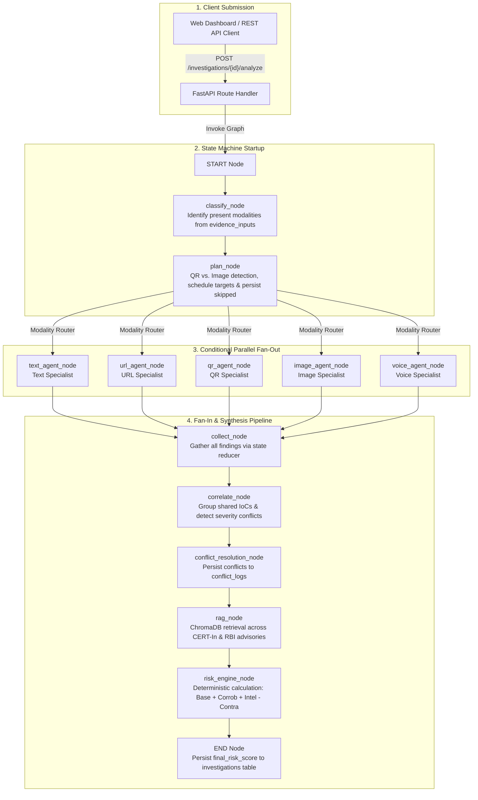

# ThreatWeave: Multi-Agent Architecture Audit & Specification
**Document Class:** Technical Architecture Specification  
**Audit Target:** `apps/api/app/agents/*`  
**Framework:** LangGraph `StateGraph`  
**Number of Implemented Agents:** Exactly 6 (1 Orchestrator Agent + 5 Modality Specialist Agents)  

---

## 1. System Overview & Swarm Topology

ThreatWeave does not rely on a single monolithic Large Language Model to process multimodal inputs. Instead, it employs a **federated, specialized multi-agent architecture** managed by a central **LangGraph StateGraph Orchestrator**. 

The architecture guarantees:
1. **Dynamic Modal Routing:** Specialized agents are dispatched only when their corresponding input modality is present in the investigation payload. Inapplicable agents are bypassed with `status='skipped'` and `latency_ms=0`.
2. **Parallel Fan-Out:** Active specialist agents execute in parallel, writing results back to state via LangGraph reducers.
3. **Decoupled Reasoning & Feature Extraction:** Feature extraction (EasyOCR, OpenCV, Faster-Whisper, lexical heuristics) runs independently of LLM synthesis.
4. **Deterministic Aggregation:** Cross-agent corroboration, conflict resolution, threat intelligence retrieval (RAG), and risk computation are performed in deterministic downstream pipeline stages.

---

## 2. End-to-End Orchestration Workflow (Mermaid Diagram)

---

## 3. Orchestrator Agent Specification

- **Primary Source Files:**
  - State Definition: [`apps/api/app/agents/orchestrator_state.py`](file:///d:/ThreatWeave%20—%20Agentic%20Multimodal/threatweave/apps/api/app/agents/orchestrator_state.py)
  - Graph Wiring: [`apps/api/app/agents/graph.py`](file:///d:/ThreatWeave%20—%20Agentic%20Multimodal/threatweave/apps/api/app/agents/graph.py)
  - Node Implementations: [`apps/api/app/agents/orchestrator_nodes.py`](file:///d:/ThreatWeave%20—%20Agentic%20Multimodal/threatweave/apps/api/app/agents/orchestrator_nodes.py)
  - Orchestration Service: [`apps/api/app/services/orchestration_service.py`](file:///d:/ThreatWeave%20—%20Agentic%20Multimodal/threatweave/apps/api/app/services/orchestration_service.py)
- **State Representation:** `InvestigationState` TypedDict containing `investigation_id`, `evidence_inputs`, `present_modalities`, `required_agents`, `active_agent_names`, `findings` (reduced via `operator.add`), `corroborations`, `conflicts`, `rag_citations`, and `risk_result`.
- **Modality Classification (`classify_node`):** Inspects `evidence_inputs` and identifies unique input types (`text`, `url`, `image`, `voice`).
- **Dynamic Planning (`plan_node`):**
  - **Text:** Direct routing to `text_agent`.
  - **URL:** Direct routing to `url_agent`.
  - **Voice:** Direct routing to `voice_agent`.
  - **Image:** Applies hybrid QR inspection:
    1. Tests image bytes with `app.core.qr_decoder.decode_qr()`.
    2. If a QR code is detected, schedules `qr_agent`.
    3. Concurrently inspects surrounding text via EasyOCR (`extract_text`): if text > 15 characters, *also* schedules `image_agent` (hybrid flyer/banner); if $\le$ 15 characters, skips `image_agent` (standalone QR).
    4. If no QR code is detected, schedules `image_agent`.
  - **Skipped Agent Persistence:** Immediately writes `AgentRun` rows with `status='skipped'` and `latency_ms=0` to PostgreSQL for all unrequired specialists.
- **Parallel Dispatch & Collection:** Uses LangGraph conditional edges (`_route_to_specialists`) to fan out across required nodes. All specialist nodes converge into `collect_node`.
- **Fault Tolerance:** Each specialist executes in an isolated try/except block with its own database session. If a specialist fails, its `AgentRun` status is updated to `failed`, an error finding is logged, and the rest of the swarm proceeds uninterrupted.

---

## 4. Specialist Agent 1: Text Agent

- **Source File & Function:** [`apps/api/app/agents/text_agent.py:analyze_text(content: str) -> EvidenceItem`](file:///d:/ThreatWeave%20—%20Agentic%20Multimodal/threatweave/apps/api/app/agents/text_agent.py#L35-L85)
- **Input Format:** Plain-text string (SMS message, email body, social media direct message).
- **Processing Architecture:**
  1. **Tier 1 (Primary LLM Path):** Submits system prompt ([`apps/api/app/agents/prompts/text_agent_prompt.py`](file:///d:/ThreatWeave%20—%20Agentic%20Multimodal/threatweave/apps/api/app/agents/prompts/text_agent_prompt.py)) and text content to Groq API (`openai/gpt-oss-120b`). Requests strictly formatted JSON output. Filters returned indicators against the global vocabulary (`app.core.indicators.VALID_INDICATORS`).
  2. **Tier 2 (Heuristic Fallback):** Triggered on API errors, rate limits, timeouts, or JSON decoding failures. Executes regex pattern scanning across 9 categories:
     - `urgency_language` (`act now`, `verify immediately`, `suspended`)
     - `credential_request` (`enter your pin`, `password reset`, `verify account`)
     - `impersonation_claim` (`support team`, `bank representative`, `helpdesk`)
     - `financial_manipulation` (`wire transfer`, `cash prize`, `lottery`)
     - `suspicious_link_mention` (`click this link`, `login here`)
     - `generic_greeting`, `spelling_grammar_anomaly`, `payment_request`, `unusual_sender_pattern`
     - Confidence is capped at 0.60; status is flagged as `"degraded_fallback"`.
  3. **Tier 3 (Safety Net):** Unhandled exceptions return `status="failed"`, `confidence=0.0`, `severity="info"`.
- **Output Evidence:** `EvidenceItem` with `agent="text_agent"`, `modality="text"`, extracted indicators, severity (`info` to `critical`), confidence score, plain-text finding, and reasoning.
- **Verification Status:** Fully implemented, verified in production and evaluated across 24 benchmark samples.
- **Unit / Integration Tests:** [`apps/api/tests/test_text_agent.py`](file:///d:/ThreatWeave%20—%20Agentic%20Multimodal/threatweave/apps/api/tests/test_text_agent.py) (9 passing tests).

---

## 5. Specialist Agent 2: URL Agent

- **Source File & Function:** [`apps/api/app/agents/url_agent.py:analyze_url(url: str) -> EvidenceItem`](file:///d:/ThreatWeave%20—%20Agentic%20Multimodal/threatweave/apps/api/app/agents/url_agent.py#L8)
- **Input Format:** URL string (HTTP, HTTPS, raw IP, or domain).
- **Processing Architecture:**
  1. **Layer 1 (Structural & Lexical Heuristics):** Invokes [`apps/api/app/core/url_heuristics.py:run_heuristics()`](file:///d:/ThreatWeave%20—%20Agentic%20Multimodal/threatweave/apps/api/app/core/url_heuristics.py). Completely network-free and deterministic:
     - **IP-as-Host:** Detects raw IPv4/IPv6 addresses in hostnames.
     - **Typosquatting & Homoglyphs:** Computes Levenshtein edit distance between the registered domain and 17 curated Indian banking/governmental targets (SBI, HDFC, ICICI, Axis, Paytm, PhonePe, GPay, Income Tax, etc.). Flags `lookalike_domain` if distance $\in [1, 2]$.
     - **Suspicious TLDs:** Flags high-abuse TLDs (`.tk`, `.ml`, `.ga`, `.xyz`, `.top`, `.click`, `.icu`, `.pw`).
     - **Shannon Entropy:** Computes character entropy on hostname and path; flags high-randomness domains (`> 4.0`).
     - **URL Shorteners:** Matches against 14 known shortening hosts (bit.ly, tinyurl, t.co).
     - **Excessive Subdomains & Missing HTTPS:** Flags depth $> 3$ subdomains or plain HTTP transport.
  2. **Layer 2 (Reputation Intelligence):** Calls [`apps/api/app/agents/reputation_client.py:check_reputation()`](file:///d:/ThreatWeave%20—%20Agentic%20Multimodal/threatweave/apps/api/app/agents/reputation_client.py) (Google Safe Browsing API v4). If confirmed malicious, upgrades severity by 1 tier.
  3. **Layer 3 (LLM Synthesis & Authority Rule):** Groq LLM synthesizes finding/reasoning narrative only. **Critical architectural rule:** The LLM *cannot* override structural heuristic severity.
  4. **Layer 4 (Safety Net):** Traps all errors and emits `status="failed"`.
- **Verification Status:** Fully implemented, verified in production and evaluated across 24 benchmark samples.
- **Unit / Integration Tests:** [`apps/api/tests/test_url_agent.py`](file:///d:/ThreatWeave%20—%20Agentic%20Multimodal/threatweave/apps/api/tests/test_url_agent.py) (14 passing tests).

---

## 6. Specialist Agent 3: QR Code Agent

- **Source File & Function:** [`apps/api/app/agents/qr_agent.py:analyze_qr(image_bytes: bytes) -> EvidenceItem`](file:///d:/ThreatWeave%20—%20Agentic%20Multimodal/threatweave/apps/api/app/agents/qr_agent.py#L8)
- **Input Format:** Binary image bytes (PNG, JPEG, WebP) containing a QR code.
- **Processing Architecture:**
  1. **QR Decoding Layer:** Uses OpenCV `cv2.QRCodeDetector` with fallback to `pyzbar`. If decode fails, returns `status="failed"` with indicator `qr_decode_failed`.
  2. **Delegation by Payload Structure:**
     - **Web URLs:** If the payload starts with `http://`, `https://`, or `www.`, the QR Agent delegates the extracted link directly to `url_agent.analyze_url(payload)`, inheriting indicators and nesting evidence under `url_analysis`.
     - **UPI Deep-Links (`upi://pay`):** Native parser extracts query parameters:
       - `pa`: Virtual Payment Address (VPA) / UPI ID.
       - `pn`: Payee Name.
       - `am`: Transaction amount.
       - `mc`: Merchant code.
       - Checks Levenshtein resemblance between Payee Name and VPA; detects mismatch or deceptive customer support keywords (`refund`, `support`, `cashback`, `official`, `electricity`); flags `qr_upi_deeplink_suspicious` and `qr_payment_request`.
     - **Arbitrary Text:** Delegates text payload directly to `text_agent.analyze_text()`.
- **Verification Status:** Fully implemented, verified in production and evaluated across 14 benchmark samples.
- **Unit / Integration Tests:** [`apps/api/tests/test_qr_agent.py`](file:///d:/ThreatWeave%20—%20Agentic%20Multimodal/threatweave/apps/api/tests/test_qr_agent.py) (11 passing tests).

---

## 7. Specialist Agent 4: Image Agent

- **Source File & Function:** [`apps/api/app/agents/image_agent.py:analyze_image(image_bytes: bytes) -> EvidenceItem`](file:///d:/ThreatWeave%20—%20Agentic%20Multimodal/threatweave/apps/api/app/agents/image_agent.py#L8)
- **Input Format:** Binary image bytes (PNG, JPEG, WebP) representing screenshots, documents, or fraud posters.
- **Processing Architecture:**
  1. **OCR Feature Extraction:** Calls EasyOCR (`app.core.ocr_engine.extract_text`) using CRAFT text detection and CRNN character recognition. Computes composite text string and mean character confidence.
  2. **Domain-Specific Visual Heuristics:**
     - `has_payment_confirmation_pattern`: Inspects OCR text for fake payment app confirmations (PhonePe, Google Pay, Paytm, transaction IDs, UTR numbers, green tick phrasing).
     - `has_impersonation_claim`: Detects police, court, or government impersonation headers (CBI, Cyber Crime Branch, arrest warrant, summons).
     - `extract_embedded_contact_info` / `extract_embedded_urls`: Finds embedded contact numbers and website links.
  3. **Genuine Sub-Agent Delegation:** Discovered links are passed to `url_agent.analyze_url()`; extracted body text is passed to `text_agent.analyze_text()`.
  4. **Severity Reconciliation:** The final severity is set to the *maximum* across text findings, URL findings, and visual heuristics (`max_severity`). The LLM cannot reduce this severity.
- **Verification Status:** Fully implemented, verified in production and evaluated across 20 benchmark samples.
- **Unit / Integration Tests:** [`apps/api/tests/test_image_agent.py`](file:///d:/ThreatWeave%20—%20Agentic%20Multimodal/threatweave/apps/api/tests/test_image_agent.py) (10 passing tests).

---

## 8. Specialist Agent 5: Voice Agent

- **Source File & Function:** [`apps/api/app/agents/voice_agent.py:analyze_voice(audio_bytes: bytes) -> EvidenceItem`](file:///d:/ThreatWeave%20—%20Agentic%20Multimodal/threatweave/apps/api/app/agents/voice_agent.py#L15)
- **Input Format:** Binary audio bytes (WAV, MP3, AAC, OGG).
- **Processing Architecture:**
  1. **Container Verification:** Validates stream headers and audio tracks via PyAV (`av.open`).
  2. **Speech-to-Text Transcription:** Executes local `faster-whisper` (`base` model, CTranslate2 int8 CPU quantization) via temporary file isolation. Extracts transcript text and segment confidences.
  3. **Vishing Forensics:**
     - `has_vishing_script_pattern`: Regex heuristics matching bank compromise alerts, digital arrest extortion, parcel customs interception, remote desktop software installation requests (`AnyDesk`, `TeamViewer`).
  4. **Acoustic Variance Analysis:** Computes energy variance and zero-crossing rate variance across audio frames. Detects abnormally flat, monotone cadence (`is_monotone_cadence`).
     - **Critical Architectural Restriction:** Labeled strictly as `ai_voice_indicator_weak`, with confidence capped at 0.40. **Never claims definitive deepfake detection.**
  5. **Text Agent Delegation:** Submits full speech transcript to `text_agent.analyze_text()` to extract social-engineering indicators.
- **Verification Status:** Fully implemented, verified in production and evaluated across 12 benchmark samples.
- **Unit / Integration Tests:** [`apps/api/tests/test_voice_agent.py`](file:///d:/ThreatWeave%20—%20Agentic%20Multimodal/threatweave/apps/api/tests/test_voice_agent.py) (12 passing tests).

---

## 9. Downstream Processing Nodes

After specialist execution converges at `collect_node`, four sequential processing nodes execute:

| Node Name | Source Module | Primary Function | Database Impact |
| :--- | :--- | :--- | :--- |
| **`correlate_node`** | [`app.agents.correlation`](file:///d:/ThreatWeave%20—%20Agentic%20Multimodal/threatweave/apps/api/app/agents/correlation.py) | Groups shared indicators across agents (`find_corroboration`); detects severity divergence ($[info, low] \leftrightarrow [high, critical]$) on related signals (`find_conflicts`). | None (in-memory state update) |
| **`conflict_resolution_node`** | [`app.agents.orchestrator_nodes`](file:///d:/ThreatWeave%20—%20Agentic%20Multimodal/threatweave/apps/api/app/agents/orchestrator_nodes.py#L358) | Records all detected conflicts to the relational database with resolution rule `contradiction_penalty_applied`. | Writes to `conflict_logs` table |
| **`rag_node`** | [`app.agents.orchestrator_nodes`](file:///d:/ThreatWeave%20—%20Agentic%20Multimodal/threatweave/apps/api/app/agents/orchestrator_nodes.py#L391), [`app.rag.retriever`](file:///d:/ThreatWeave%20—%20Agentic%20Multimodal/threatweave/apps/api/app/rag/retriever.py) | Formulates dense query from discovered IoCs and text; retrieves top-5 citations from ChromaDB clearing threshold 0.40. | Writes to `rag_citations` table |
| **`risk_engine_node`** | [`app.agents.risk_engine`](file:///d:/ThreatWeave%20—%20Agentic%20Multimodal/threatweave/apps/api/app/agents/risk_engine.py) | Evaluates deterministic formula $b + \Delta_c + \Delta_i - \Delta_k$; maps score to severity band. | Writes to `risk_breakdown`, updates `investigations` |
