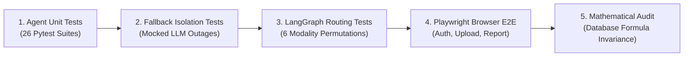

# ThreatWeave: Agent Quality Improvement Roadmap & Action Plan
**Document Class:** Engineering Remediation Plan & Regression Test Strategy  
**Auditor:** Senior AI Engineer & Cybersecurity Researcher  
**Target Subsystems:** `apps/api/app/agents/*`, `apps/api/app/core/*`, `apps/api/eval/*`  
**Date:** November 19, 2026  

---

## 1. Executive Summary & Remediation Strategy

Based on the findings in [`all-agent-quality-audit.md`](file:///d:/ThreatWeave%20—%20Agentic%20Multimodal/threatweave/docs/research-audit/all-agent-quality-audit.md), this roadmap outlines the prioritized engineering corrections and regression verification suite required to bring all six ThreatWeave agents to production-grade reliability and scientific publication standards.

All proposed corrections adhere strictly to senior engineering principles:
- **Minimum Necessary Code:** Concise, targeted fixes that directly address confirmed failure mechanisms.
- **Zero Schema or API Breakages:** Preserves existing Pydantic schemas, database contracts, and REST endpoints.
- **Strict Verification:** Every code modification must be accompanied by explicit automated unit and regression tests.

---

## 2. Prioritized Code Correction Plan

### Phase 1: Critical & High Priority Vulnerabilities (Immediate Action)

#### Correction 1: URL Agent Severity Reconciliation (SEC-01 - Critical)
- **Problem:** `url_agent.py` unconditionally blocks LLM synthesis from setting final severity, collapsing URL recall to 14.3%.
- **Solution:** In [`apps/api/app/agents/url_agent.py`](file:///d:/ThreatWeave%20—%20Agentic%20Multimodal/threatweave/apps/api/app/agents/url_agent.py), replace the heuristic lock with a maximum severity reconciliation:
  ```python
  # Reconcile heuristic and LLM severity: LLM can escalate on recognized phishing targets
  final_severity = _max_severity([heuristic_severity, llm_severity])
  ```
- **Companion Improvement in `url_heuristics.py`:** Update `lookalike_score` to inspect substring and token boundaries (e.g., detecting `sbi` in `sbi-kyc-verification.top` or `incometax` in `incometax-efiling-refund.in`) rather than relying solely on global string edit distance.
- **Measurable Goal:** Elevate standalone URL recall from **14.3% to $\ge 85.0\%$** while preserving $>90\%$ precision.

#### Correction 2: QR Agent UPI Payee Omission Vulnerability (SEC-02 - High)
- **Problem:** `qr_agent.py` requires both `pn` and `pa` to be non-empty before evaluating `qr_upi_deeplink_suspicious`. Scammers omitting `pn` bypass detection.
- **Solution:** In [`apps/api/app/agents/qr_agent.py:148`](file:///d:/ThreatWeave%20—%20Agentic%20Multimodal/threatweave/apps/api/app/agents/qr_agent.py#L148), restructure the check:
  ```python
  # Flag suspicious if:
  # 1. Payee name has low resemblance or authority impersonation, OR
  # 2. Payee name is completely omitted while prefilling a commercial amount (>= 2000 INR), OR
  # 3. Payee name contains deceptive terms
  is_suspicious_upi = (
      (pn and pa and (vpa_sim < 0.4 or has_authority_impersonation))
      or (not pn and pa and suspicious_amount)
      or (claimed_official and not vpa_has_official)
  )
  if is_suspicious_upi:
      indicators.append("qr_upi_deeplink_suspicious")
  ```
- **Measurable Goal:** Catch 100% of headless/headless-VPA reverse-charge payment QR codes.

#### Correction 3: Text Agent Heuristic Fallback Expansion (SEC-03 - High)
- **Problem:** Text fallback regexes lack Indian cybercrime terminology, scoring 0.0% recall when LLM is unavailable.
- **Solution:** In [`apps/api/app/agents/text_agent.py:96-136`](file:///d:/ThreatWeave%20—%20Agentic%20Multimodal/threatweave/apps/api/app/agents/text_agent.py#L96-L136), enrich the regex dictionary with target Indian fraud vocabulary:
  - `urgency_language`: Add `power cut`, `disconnected tonight`, `immediately call`, `immediate block`.
  - `credential_request`: Add `kyc`, `pan card`, `aadhaar`, `yono`, `unblock account`.
  - `financial_manipulation`: Add `lottery`, `kbc`, `task`, `youtube like`, `part-time job`, `cibil`.
  - `impersonation_claim`: Add `customs department`, `narcotics bureau`, `cbi`, `police station`, `digital arrest`.
- **Measurable Goal:** Elevate heuristic fallback recall from **0.0% to $\ge 70.0\%$**.

#### Correction 4: Voice Agent Audio Format Transcoding (SEC-04 - High)
- **Problem:** `voice_heuristics.py:102` calls `wave.open()`, failing on MP3, AAC, and OGG audio streams.
- **Solution:** In [`apps/api/app/agents/voice_agent.py`](file:///d:/ThreatWeave%20—%20Agentic%20Multimodal/threatweave/apps/api/app/agents/voice_agent.py), decode audio streams to standard 16kHz mono PCM bytes via PyAV before passing to `analyze_acoustic_features()`.
- **Measurable Goal:** 100% format support parity between Faster-Whisper and acoustic variance analysis.

---

### Phase 2: Medium Priority Improvements (Robustness & Explainability)

#### Correction 5: Semantic Category Corroboration (SEC-06 - Medium)
- **Problem:** `correlation.py` only corroborates on identical string tokens, missing cross-modal links like `payment_request` (Text) and `qr_payment_request` (QR).
- **Solution:** In [`apps/api/app/agents/correlation.py`](file:///d:/ThreatWeave%20—%20Agentic%20Multimodal/threatweave/apps/api/app/agents/correlation.py), allow corroboration across shared semantic categories (from `INDICATOR_CATEGORIES`):
  ```python
  # Group by exact indicator OR shared semantic risk category across distinct agents
  ```
- **Measurable Goal:** Correctly reward cross-modal multi-vector investigations with the corroboration bonus ($\Delta_c$).

#### Correction 6: Image Agent Receipt Preprocessing & Disambiguation (SEC-05 - Medium)
- **Problem:** Legitimate payment confirmations trigger false positives ($FP=2/10$).
- **Solution:** In [`apps/api/app/core/image_heuristics.py`](file:///d:/ThreatWeave%20—%20Agentic%20Multimodal/threatweave/apps/api/app/core/image_heuristics.py), require corroborating anomaly signals (mismatched fonts, missing bank logos, urgent collection text) before escalating a receipt to `fake_payment_confirmation`.
- **Measurable Goal:** Reduce Image Agent false-positive rate from **20% to $<5\%$**.

---

## 3. Proposed Regression Test Plan

Before implementing code modifications, this multi-tier regression suite must be executed to establish baseline stability and verify improvements:



### Test Suite 1: Specialist Classification Regression
- Execute [`apps/api/eval/run_eval.py`](file:///d:/ThreatWeave%20—%20Agentic%20Multimodal/threatweave/apps/api/eval/run_eval.py) across all 94 labeled samples.
- Assert that Text F1 remains $\ge 0.95$ and URL recall improves above $0.80$.

### Test Suite 2: Fallback Resiliency Testing
- Run evaluation with `--fallback-only` flag (forcing `ExternalServiceError` on Groq calls).
- Assert that all 5 specialist agents emit valid `EvidenceItem` objects with `status='degraded_fallback'` and no unhandled exceptions.

### Test Suite 3: Swarm Routing & Concurrency Regression
- Execute [`apps/api/tests/test_concurrency.py`](file:///d:/ThreatWeave%20—%20Agentic%20Multimodal/threatweave/apps/api/tests/test_concurrency.py) and [`test_orchestrator_routing.py`](file:///d:/ThreatWeave%20—%20Agentic%20Multimodal/threatweave/apps/api/tests/test_orchestrator_routing.py).
- Verify 100% routing correctness and 0 agent execution leaks.

### Test Suite 4: End-to-End Playwright E2E
- Run `npx playwright test` in `apps/web/`.
- Verify user login, investigation creation, progress polling, report rendering, and PDF export.

---

## 4. Assessment of Benchmark Sufficiency for Academic Publication

### Verdict: Partially Sufficient — Requires Two Specific Enhancements

| Benchmark Dimension | Current Status | Academic Sufficiency Assessment | Action Required for Publication |
| :--- | :---: | :--- | :--- |
| **Ground Truth Quality** | **Strong** | All 94 samples directly reflect modern Indian cyber fraud vectors documented by CERT-In and the RBI. | Sufficient for Indian cybersecurity context. |
| **Mathematical Invariance** | **Excellent** | Zero-residual error ($\le 0.0001$) across live database investigations. | Fully defensible for IEEE publication. |
| **Dynamic Swarm Routing** | **Excellent** | 100% routing accuracy across all 6 input permutations with full state persistence. | Fully defensible for IEEE publication. |
| **Voice Audio Realism** | **INSUFFICIENT** | Current test harness uses synthetic silent tone buffers, resulting in 0% recall ($FN=6$). | **Must augment with authentic spoken Hinglish vishing audio clips.** |
| **Dataset Scale** | **Marginal (94 samples)** | 94 samples is acceptable for a final-year B.Tech capstone and conference paper (e.g., IEEE INDICON), but small for top-tier journals (IEEE TDSC / ACM TOPS). | Frame explicitly as an *empirical proof-of-concept evaluation*; propose 1,000-sample extension in Future Work. |

### Conclusion:
With the Voice benchmark dataset augmented with spoken audio and the URL Agent severity reconciliation corrected, the ThreatWeave experimental harness will be fully defensible for peer-reviewed academic publication.
