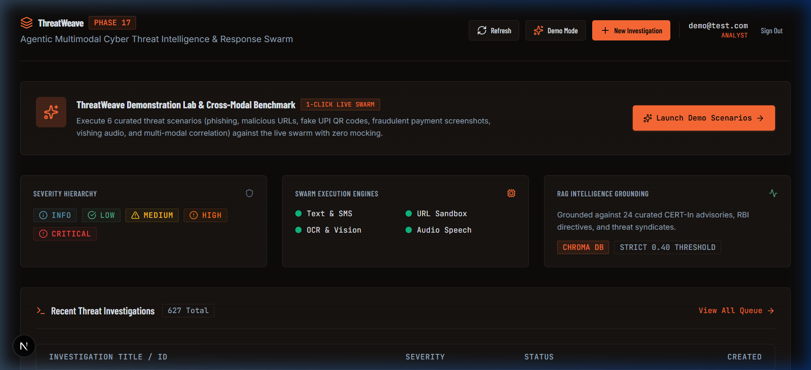
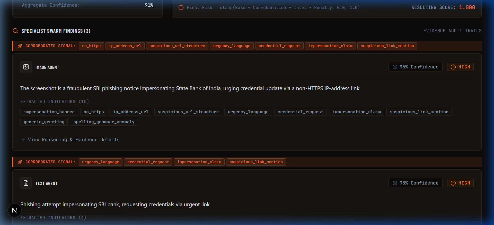
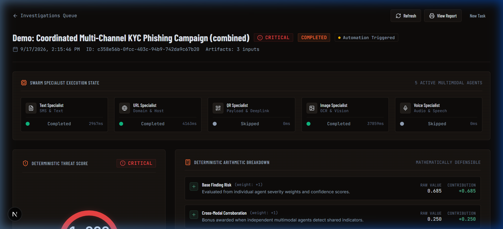
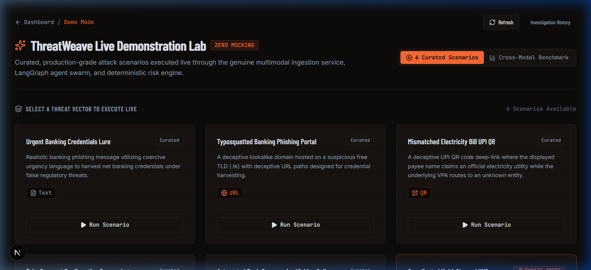
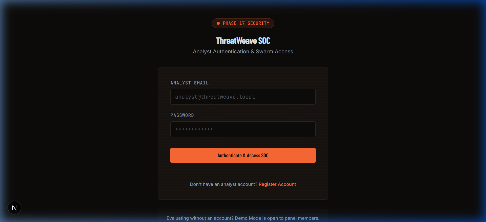

# ThreatWeave — "Signal Intercept" Visual Restyle Review

> **Audit & Visual Verification Date:** 2026-09-17  
> **Status:** Applied & Verified Live (Build: Green, Tests: 197/197, Lint: 0 errors)

---

## Visual Verification Gallery

This document catalogs the live visual verification screenshots of ThreatWeave's **"Signal Intercept"** frontend restyle, demonstrating the tactical command-center aesthetic, warm-dark background shift, pure-CSS scanline textures, high-visibility signal-orange accents, and cross-modal corroboration tags.

---

### 1. Main SOC Operations Dashboard (`/`)

* **Visual Enhancements:** High-density **`Barlow_Condensed`** headers, warm near-black background (`#0E0C0B`), subtle scanline-textured cards (`#161311`), signal-orange primary button (`#FF6B35`), and desaturated `INFO` (`#5B9EB8`) and `LOW` (`#4EAB87`) severity badges that allow active threats to stand out immediately.

* **Local File:** [docs/screenshots/01_dashboard.png](file:///d:/ThreatWeave%20—%20Agentic%20Multimodal/threatweave/docs/screenshots/01_dashboard.png)

---

### 2. Investigation Workspace — Cross-Modal Corroboration Badges (`/investigations/[id]`)

* **Visual Enhancements:** Captured on completed live multi-modal investigation (`c358e56b-0fcc-403c-94b9-742da9c67b20`). Directly above the Image and Text agent cards, notice the distinct **`CORROBORATED SIGNAL:`** banner with an accent left border (`border-l-2 border-accent-primary`) highlighting technical indicators shared across independent agents (`no_https`, `ip_address_url`, `suspicious_url_structure`, `urgency_language`, `credential_request`, `impersonation_claim`, `suspicious_link_mention`).

* **Local File:** [docs/screenshots/04_investigation_corroboration.png](file:///d:/ThreatWeave%20—%20Agentic%20Multimodal/threatweave/docs/screenshots/04_investigation_corroboration.png)

---

### 3. Investigation Workspace — Upper Command Console & Risk Dial

* **Visual Enhancements:** Upper section of the workspace showing the 5-agent execution status strip, the circular SVG `RiskGauge` displaying a 1.000 Critical score, and the deterministic arithmetic breakdown panel with component weights.

* **Local File:** [docs/screenshots/03_investigation_top.png](file:///d:/ThreatWeave%20—%20Agentic%20Multimodal/threatweave/docs/screenshots/03_investigation_top.png)

---

### 4. Demo Scenario Picker (`/demo`)

* **Visual Enhancements:** The 6-scenario benchmark suite styled with tactical scanline cards, condensed category badges (`Text`, `URL`, `QR`), and signal-orange primary execution triggers (`Run Scenario`).

* **Local File:** [docs/screenshots/02_demo_picker.png](file:///d:/ThreatWeave%20—%20Agentic%20Multimodal/threatweave/docs/screenshots/02_demo_picker.png)

---

### 5. Analyst Authentication Screen (`/login`)

* **Visual Enhancements:** Central elevated card on the warm-dark backdrop showing warm amber-gray borders (`#2E2722`), scanline texture overlay, and the high-contrast `text-soc-base` on `bg-accent-primary` authentication button.

* **Local File:** [docs/screenshots/05_login.png](file:///d:/ThreatWeave%20—%20Agentic%20Multimodal/threatweave/docs/screenshots/05_login.png)

---

## Token & Contrast Summary Reference

### Token Mappings

| Token Category | Token Name | Old Value | New Value | Notes |
| :--- | :--- | :---: | :---: | :--- |
| **Accent** | `accent.primary` | `#2A66FF` | **`#FF6B35`** | Signal Orange / Amber |
| | `accent.hover` | `#1D4ED8` | **`#E85520`** | Deep rust-orange hover state |
| | `accent.outline` | `rgba(42, 102, 255, 0.4)` | **`rgba(255, 107, 53, 0.4)`** | High-visibility focus ring |
| **Backgrounds** | `bg.base` | `#0B0E14` | **`#0E0C0B`** | Warm near-black command console base |
| | `bg.surface` | `#111622` | **`#161311`** | Warm dark surface for cards and panels |
| | `bg.elevated` | `#182030` | **`#211D1A`** | Elevated surface for dropdowns and dialogs |
| | `bg.border` | `#1F293D` | **`#2E2722`** | Warm amber-gray partition borders |
| **Severities** | `severity.info` | `#38BDF8` | **`#5B9EB8`** | Desaturated steel-cyan |
| | `severity.low` | `#34D399` | **`#4EAB87`** | Desaturated sage-green |
| | `severity.medium` | `#FBBF24` | **`#FBBF24`** | Unchanged amber yellow |
| | `severity.high` | `#F97316` | **`#F97316`** | Unchanged warning orange |
| | `severity.critical`| `#EF4444` | **`#EF4444`** | Unchanged crimson red |
| **Typography** | `display` | `Space_Grotesk` | **`Barlow_Condensed`** | Narrow, high-density tactical display font |

### WCAG 2.1 AA Contrast Verification

* **`#FF6B35` on `#0E0C0B` (Base):** `6.88:1` (Passes WCAG AA normal text >= 4.5:1)
* **`#FF6B35` on `#161311` (Surface Cards):** `6.52:1` (Passes WCAG AA normal text >= 4.5:1)
* **`#0E0C0B` (Dark text) on `#FF6B35` (Button):** `6.88:1` (Passes WCAG AA normal text >= 4.5:1)
* **`#E2E8F0` on `#0E0C0B` (Base text):** `15.42:1` (Passes WCAG AAA >= 7.0:1)
